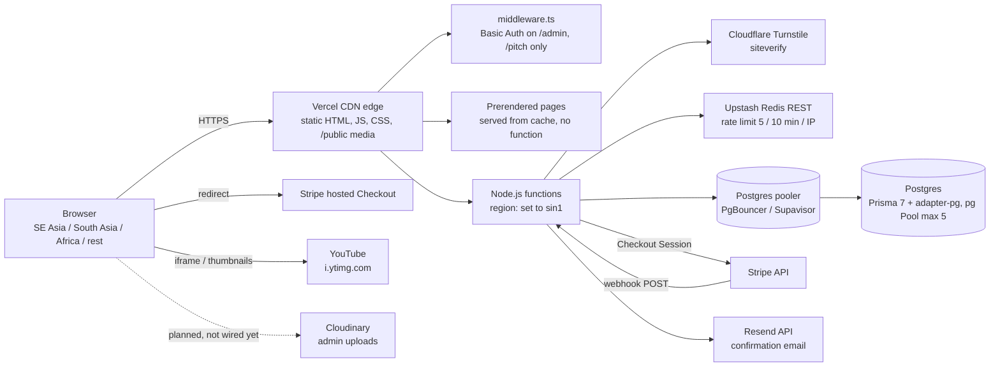

# Infrastructure and database plan

Prepared 16 Oct 2026 for the thegyn.org rebuild (Next.js 16.4.2, Prisma 7.10.1 with `@prisma/adapter-pg`, Stripe Checkout, Resend, Upstash Redis, Cloudflare Turnstile, Cloudinary). Every price and limit below links to the page it came from, fetched 16 Oct 2026. Anything I could not confirm on a live page says **unverified**. Request rates are my estimates, built from the rows-per-year table in [schema.md](schema.md) plus assumptions that are written down next to them.

Short version: run on **Vercel Pro** with functions pinned to Singapore, **Neon Launch** in Singapore as the database, Upstash Free, Resend Pro, Cloudinary Free and Turnstile Free. About **$80/month** in a launch month, about **$180/month** at 10×. Vercel Hobby is not allowed for this site because it takes payments.

---

## 1. Current architecture



Static vs dynamic, read from `app/` and the route segment exports (no build was run, per the build rule in [api-contract.md](api-contract.md)):

| Route | Type | Why |
|---|---|---|
| `/`, `/about-us`, `/fms-thailand`, `/sism-2026`, `/sism-forum-access`, `/sism-self-funded`, `/sism-invitation-letter`, `/privacy-policy`, `/refund-policy`, `/terms-conditions`, `/sism-2026/registration-cancelled`, `/pitch`, `/admin`, `not-found` | Static | No `searchParams`, `cookies()`, `headers()` or uncached fetch on the server. `/admin` is sample data today; it goes dynamic when it reads the database |
| `/videos` | Static shell | `useSearchParams` in a client component inside a Suspense boundary (commit 4cb3077), so the page prerenders |
| `/contact-us` | Dynamic | Server component awaits `searchParams` |
| `/sism-2026/registered` | Dynamic | Server component awaits `searchParams` (`ref`, `ticket`, `demo`) |
| `POST /api/registrations` | Dynamic | `runtime = "nodejs"`, `dynamic = "force-dynamic"` |
| `POST /api/contact` | Dynamic | `runtime = "nodejs"`, `dynamic = "force-dynamic"` |
| `POST /api/webhooks/stripe` | Dynamic | `runtime = "nodejs"`, `dynamic = "force-dynamic"` |
| `GET /api/calendar/sism-2026.ics` | Static | `dynamic = "force-static"` |
| `/admin/*`, `/pitch/*` | Middleware runs | `middleware.ts` matcher; Basic Auth only when `ADMIN_BASIC_AUTH` / `PITCH_BASIC_AUTH` are set |

So almost all public traffic is served from the CDN without touching a function or the database. Only the registration flow, the contact form and two pages that read query strings run code.

What one paid registration costs the backend, counted from the code:

- `POST /api/registrations`: 1 Turnstile call, 1 Upstash pipeline (4 commands: ZREMRANGEBYSCORE, ZADD, ZCARD, EXPIRE), about 8 SQL statements (`getTicket`, `referenceExists`, a transaction with BEGIN + 3 INSERTs + COMMIT, `setPaymentSession`), 1 Stripe API call.
- `POST /api/webhooks/stripe` for `checkout.session.completed`: about 7 SQL statements (insert `WebhookEvent`, find payment, a 2-update transaction, load details), 1 Resend call.
- `GET /sism-2026/registered`: 1 render, no database read.

That is 3 to 4 function invocations, about 15 SQL statements and 1 email per paid registration.

Things to fix before launch that this doc depends on:

- Vercel runs functions in `iad1` (Washington) by default ([functions limits](https://vercel.com/docs/functions/limitations), fetched 16 Oct 2026). With the database in Singapore every query would cross the Pacific. Set the project's function region to `sin1`.
- `lib/db.ts` comments and `.env.example` still describe Supabase and use `?pgbouncer=true&connection_limit=1`. With `@prisma/adapter-pg`, the `pg` Pool's `max: 5` is what limits connections; whether adapter-pg reads those two URL parameters at all is **unverified**. Update `.env.example` to the chosen provider's pooled URL when the account exists.
- The webhook catches a Resend failure, logs it and still returns 200, so Stripe will not retry and the confirmation email is lost. Fine at launch volume, not fine once Resend starts returning 429 (see section 4).
- The rate limit key is the client IP, shared by `/api/registrations` and `/api/contact`, 5 requests per 10 minutes. A school group registering from one campus Wi-Fi will hit it. Watch the 429 count on launch day.

---

## 2. Load profile

Inputs from [schema.md](schema.md): up to 4,200 registrations a year across 2 summits, so about **2,100 registration attempts per summit** at the top of the range (100 confirmed seats, 500 to 2,000 scholarship applicants, 20 to 50 invitation letters). I use the top of the range everywhere.

My assumptions (change these and the numbers move linearly):

| # | Assumption | Value |
|---|---|---|
| A1 | Share of a summit's attempts on launch day, and again on deadline day | 25% each |
| A2 | Share of that day's traffic in the busiest hour | 20% |
| A3 | Peak minute vs busy-hour average | 3× |
| A4 | Page views per registration attempt (browsers who leave, repeat visits) | 30 |
| A5 | CDN requests per page view (HTML/RSC, JS chunks, CSS, fonts, images, video) | 30 |
| A6 | Average bytes per page view (home page globe video is 1.4 MB WebM; other pages lighter; repeat visits cached) | 1.5 MB |
| A7 | Emails per summit | 1 per attempt (confirmation) + 1 per attempt (scholarship result or follow-up) = 4,200 |
| A8 | Monthly bills assume a whole summit cycle lands in one month | worst case |

Busy hour on launch day = 2,100 × 25% × 20% = **105 registration attempts per hour**.

Peak rates (busy-hour average / peak minute):

| Metric | Launch (1×) | 10× (regional event) | 100× (viral, e.g. a UN post) |
|---|---|---|---|
| Registration attempts/s | 0.03 / 0.09 | 0.3 / 0.9 | 2.9 / 8.8 |
| Function invocations/s (≈4 per attempt) | 0.12 / 0.35 | 1.2 / 3.5 | 12 / 35 |
| Page views/s | 0.9 / 2.6 | 8.8 / 26 | 88 / 263 |
| CDN requests/s | 26 / 79 | 263 / 788 | 2,625 / 7,875 |
| SQL statements/s (≈15 per attempt) | 0.4 / 1.3 | 4.4 / 13 | 44 / 131 |
| Upstash commands/s | 0.12 / 0.35 | 1.2 / 3.5 | 12 / 35 |
| Resend calls/s | 0.03 / 0.09 | 0.3 / 0.9 | 2.9 / 8.8 |

Monthly volume (A8):

| Metric | Launch | 10× | 100× |
|---|---|---|---|
| Page views | 63,000 | 630,000 | 6.3M |
| CDN requests | 1.9M | 19M | 189M |
| CDN data transfer | ~95 GB | ~945 GB | ~9.5 TB |
| Function invocations (registration path) | ~8,400 | ~84,000 | ~840,000 |
| Emails | ~4,200 | ~42,000 | ~420,000 |
| Database size | well under 1 GB at every tier (schema.md: "a few hundred thousand rows" for years) |||

The database is never the bottleneck: 131 simple statements a second at the 100× peak is light work for one small Postgres compute (confirm with the load test in section 7). The CDN is where the money goes, and only because of request count and the video. Also, 100× does not mean 100× paid seats: there are 100 seats. A viral post multiplies browsing (static, CDN) and maybe scholarship applications, not confirmed seats.

Limits that sit close to these numbers:

- Resend: **10 requests/s per team** by default, same on every plan ([Resend rate limit](https://resend.com/docs/api-reference/rate-limit), [pricing](https://resend.com/pricing), fetched 16 Oct 2026). The 100× peak minute reaches 8.8/s.
- Upstash Redis: 10,000 commands/s on Free and pay-as-you-go ([Upstash Redis pricing](https://upstash.com/pricing/redis), fetched 16 Oct 2026). Far away.
- Vercel functions auto-scale to 30,000 concurrency on Hobby and Pro ([functions limits](https://vercel.com/docs/functions/limitations), fetched 16 Oct 2026). Far away.
- Neon pooler accepts 10,000 client connections; a 0.25 CU compute has `max_connections` 104, 97 usable ([Neon connection pooling](https://neon.com/docs/connect/connection-pooling), fetched 16 Oct 2026). With `max: 5` per function instance that is room for about 19 instances talking straight to Postgres, and far more through the pooler.

---

## 3. Database comparison

All figures fetched 16 Oct 2026.

| | Neon Free | Neon Launch | Supabase Free | Supabase Pro | MongoDB Atlas M0 | Prisma Postgres Starter |
|---|---|---|---|---|---|---|
| Price | $0 | Usage only, no minimum; $0.106/CU-hour, $0.35/GB-month | $0 | From $25/month incl. $10 compute credit (covers Micro) | $0 | $10/month |
| Storage | 1 GB per project, 20 GB account total | Billed per GB, no hard cap | 500 MB | 8 GB disk, then $0.125/GB | 512 MB | 10 GB, then $2/GB |
| Compute | 100 CU-hours per project per month, autoscale to 2 CU; compute suspended until next period if exceeded | Autoscale to 16 CU | Nano (shared, up to 0.5 GB RAM) | Micro (shared, 1 GB); Small ~$15, Medium ~$60 | Shared, 100 ops/s | 1M operations included, then $8 per extra million |
| Connections | Pooler 10,000 clients; `max_connections` 104 at 0.25 CU | Same, scales with CU (419 at 1 CU) | 60 direct / 200 pooler | Micro 60 / 200; Small 90 / 400 | 500 | 100 pooled / 10 direct |
| Pooler | PgBouncer, transaction mode, included | Same | Supavisor | Supavisor (port 6543 transaction mode for serverless) | n/a | Included |
| Backups / PITR | 6-hour restore window (1 GB history cap), 1 manual snapshot, no scheduled backups | Restore window up to 7 days at $0.20/GB-month; 100 manual snapshots | None | Daily, kept 7 days. PITR add-on $100/month for 7 days, needs Small compute | Pricing page says no backups; limits doc says a daily snapshot can be enabled, up to 4 kept (pages disagree) | Daily, 7-day retention. PITR not listed |
| Branching | 10 branches per project | 10 included, extra $1.50/branch-month | Not included | $0.01344 per branch-hour | n/a | n/a |
| Regions near the audience | Singapore only in Asia. No India, no Africa | Same | Singapore, Mumbai. No Africa | Same | Subset of AWS/GCP/Azure regions, not listed on the page | Singapore, Tokyo. No India, no Africa |
| Idle behaviour | Scales to zero after 5 min, cannot be disabled (wakes on next connection) | Scale to zero after 5 min, can be disabled | **Paused after 1 week of inactivity** | Never paused | Paused after 30 days with zero connections | **unverified** |
| SLA | None | None | n/a | **unverified** | None | **unverified** |

Sources: [neon.com/pricing](https://neon.com/pricing), [Neon plans](https://neon.com/docs/introduction/plans), [Neon regions](https://neon.com/docs/introduction/regions), [Neon pooling](https://neon.com/docs/connect/connection-pooling), [supabase.com/pricing](https://supabase.com/pricing), [Supabase compute](https://supabase.com/docs/guides/platform/compute-and-disk), [Supabase regions](https://supabase.com/docs/guides/platform/regions), [Supabase backups](https://supabase.com/docs/guides/platform/backups), [mongodb.com/pricing](https://www.mongodb.com/pricing), [Atlas free cluster limits](https://www.mongodb.com/docs/atlas/reference/free-shared-limitations/), [prisma.io/pricing](https://www.prisma.io/pricing), [Prisma Postgres FAQ](https://www.prisma.io/docs/postgres/faq). All fetched 16 Oct 2026. Third-party comparisons from the extended searches agreed with these vendor pages, and where an older blog quoted Neon Free at 0.5 GB or 191.5 CU-hours I used the vendor page instead.

**Prisma Accelerate.** Don't adopt it. Prisma's own docs say "Prisma Accelerate, including hosted Accelerate connections for Prisma Postgres, will be retired on December 1, 2026" ([Accelerate docs](https://www.prisma.io/docs/accelerate), fetched 16 Oct 2026). That is six weeks after launch. Both Neon and Supabase ship a pooler in the plan, and the app already pools in-process with `pg.Pool`. Use the provider's pooled URL for `DATABASE_URL` and the direct URL for `DIRECT_URL` (migrations), which is how `prisma.config.ts` is already set up.

**Why not MongoDB.** The schema is relational all the way through: Registration points at Event, Attendee, TicketType and DiscountCode; Payment and Refund hang off Registration; the webhook confirms a Payment and a Registration in one transaction; `WebhookEvent.providerEventId` and `Registration.idempotencyKey` rely on unique constraints to stop double processing. Postgres gives foreign keys, unique constraints and multi-row transactions for free. In a document store we would rebuild those by hand, and Prisma 7's `@prisma/adapter-pg` path we already wrote would be thrown away. M0 is also capped at 100 ops/s and 512 MB.

**Why the free tiers are out for production.** This site takes money. Supabase Free pauses after a week with no database traffic, and between summits almost every page is static, so a week without a query is likely; it also has no backups. Neon Free suspends compute when the 100 CU-hours run out: 0.25 CU busy for 400 hours uses it all, and a launch month with registrations every few minutes could get there, which means checkout breaks mid-sale. Its 6-hour restore window is too short to catch a bad migration found the next morning. Both free tiers are fine for preview deployments and local dev.

**Neon Launch vs Supabase Pro.** Both work with the code as written. Neon wins on three points that matter here: point-in-time restore for 7 days costs cents (history storage at $0.20/GB-month on a database under 1 GB) where Supabase charges $100/month for PITR plus a Small compute; branches per preview deployment are included; and the bill follows usage, about $19/month with 0.25 CU always on. Supabase wins on region choice (Mumbai as well as Singapore) and a fixed bill. Mumbai does not help much in practice: the function runs in one region and talks to the database there, and Singapore is the right place for a Kuala Lumpur summit with South Asian and Southeast Asian delegates. African users get Singapore latency on the few dynamic requests either way, since neither provider has an African region; static pages come from the nearest CDN edge.

---

## 4. What changes at each tier

| Component | Launch | 10× | 100× |
|---|---|---|---|
| Vercel | Pro, 1 deploying seat, functions in `sin1` | Same; raise Flat Rate CDN tier | Same; top Flat Rate CDN tier, trim requests per page |
| Database | Neon Launch, Singapore, 0.25 CU, scale to zero **off** in launch and deadline weeks | Autoscale 0.25 to 1 CU | Autoscale 0.25 to 2 CU; consider Scale plan for the SLA |
| Pooler | Neon PgBouncer (`-pooler` host), `pg` Pool `max: 5` | Same | Same; check `max_connections` headroom in the load test |
| Upstash Redis | Free | Free | Pay as you go |
| Email queue | None (inline send, < 0.1 email/s) | Optional | Required: Upstash QStash between webhook and Resend |
| Resend | Pro $20 (50k/month) | Pro $20 | Scale $350 (500k/month) |
| Cloudinary | Free, as upload store and image origin only | Free | Free |
| Turnstile | Free | Free | Free |

Why each line:

**Vercel plan.** Hobby is out at every tier. Vercel's fair use page says "Hobby teams are restricted to non-commercial personal use only" and lists "Any method of requesting or processing payment from visitors of the site" as commercial use ([fair use guidelines](https://vercel.com/docs/limits/fair-use-guidelines), fetched 16 Oct 2026). Donations alone would be fine; ticket sales are not. Pro is $20/month per deploying seat with $20 of monthly usage credit and free viewer seats ([Pro plan](https://vercel.com/docs/plans/pro-plan), fetched 16 Oct 2026).

Vercel limits that matter:

| Limit | Hobby | Pro | Source |
|---|---|---|---|
| Function max duration (Fluid compute) | 300 s default and max | 300 s default, 800 s max, 1800 s beta | [functions limits](https://vercel.com/docs/functions/limitations) |
| Function memory | 2 GB / 1 vCPU | up to 4 GB / 2 vCPU | same |
| Request/response body | 4.5 MB | 4.5 MB | same |
| Data transfer | 100 GB/month, then wait 30 days | Flat Rate CDN: 1 TB and 1M CDN requests included | [Hobby](https://vercel.com/docs/plans/hobby), [Flat Rate CDN](https://vercel.com/docs/pricing/flat-rate-cdn) |
| Function invocations | 1M/month | $0.60 per 1M | [fair use](https://vercel.com/docs/limits/fair-use-guidelines) |
| Active CPU | 4 hours/month | $0.16/hour in sin1 | [Hobby](https://vercel.com/docs/plans/hobby), [sin1 pricing](https://vercel.com/docs/pricing/regional-pricing/sin1) |
| Image transformations | 5,000/month | $0.0605 per 1K in sin1 | same |
| Runtime logs | 1 hour | 1 day | [Hobby](https://vercel.com/docs/plans/hobby) |

All fetched 16 Oct 2026. Our longest function call is a Stripe round trip, a few seconds at worst, so 300 s is never a constraint.

Flat Rate CDN tiers on Pro: included tier 1M requests / 1 TB; $20/month for 10M / 50 TB; $100/month for 50M / 50 TB; $300/month for 150M / 50 TB. Going over moves you up a tier at the start of the next billing cycle, a one-day spike does not, and past the top tier you go to on-demand pricing ([Flat Rate CDN](https://vercel.com/docs/pricing/flat-rate-cdn), fetched 16 Oct 2026). On-demand is $2.00 to $3.20 per 1M CDN requests and $0.15 to $0.35 per GB depending on region ([regional pricing](https://vercel.com/docs/pricing/regional-pricing), fetched 16 Oct 2026). The same page says Flat Rate is not for sites where "large-scale delivery of media" is the majority of bandwidth. The 1.4 MB globe WebM on the home page is a large share of our bytes, so keep it small or move it off Vercel if transfer grows.

By my estimate (A5) the launch month alone is 1.9M CDN requests, already past the included 1M. Budget the $20 tier; if the usage dashboard shows fewer than 1M requests after launch, drop back.

**Database.** Neon Launch compute at $0.106/CU-hour ([neon.com/pricing](https://neon.com/pricing), fetched 16 Oct 2026): 0.25 CU × 730 h = 182.5 CU-hours = **$19.35/month** always on. With scale to zero left on outside registration windows it is lower; I budget the always-on figure. 10×: average 0.5 CU = $38.69. 100×: average 1 CU = $77.38 (my estimate of average size, not a measured one). Storage under 1 GB at $0.35/GB-month and restore history at $0.20/GB-month add under $1. Turning off scale to zero in busy weeks avoids a cold start on the first checkout after an idle spell; Neon's Prisma guide recommends `connect_timeout=15` on the URL for the same reason ([Neon + Prisma](https://neon.com/docs/guides/prisma), fetched 16 Oct 2026). Neon's Prisma guide shows `@prisma/adapter-neon`; we use `@prisma/adapter-pg` over TCP against the pooled host, which is standard Postgres, but that combination is **unverified** on Neon's pages. The load test settles it.

**Upstash Redis.** Free: 500K commands/month, 10,000 commands/s, 250 MB; pay as you go is $0.20 per 100K commands ([Upstash Redis pricing](https://upstash.com/pricing/redis), fetched 16 Oct 2026). Each rate-limit check sends a 4-command pipeline. Whether Upstash bills that as 4 commands or 1 is **unverified**; I assume 4. Launch: ~8,400 commands. 10×: ~84,000. 100×: ~840,000, over the free 500K, so about $1.70 on pay as you go. Upstash region list was not on the pages I fetched (**unverified**); pick the region closest to `sin1` in the console.

**Email and the queue.** Resend Free is 3,000 emails/month and **100 per day** ([resend.com/pricing](https://resend.com/pricing), fetched 16 Oct 2026). Launch day alone sends ~525 confirmations (2,100 × 25%), so Free fails on day one. Pro is $20 for 50,000/month with no daily cap; Scale is $90 (100k), $160 (200k), $350 (500k), $650 (1M). The 10 requests/s team limit is the reason for a queue at 100×: the peak minute hits 8.8 sends/s before retries, and today a 429 means a lost email. QStash Free is 1,000 messages/day; pay as you go is $1 per 100K messages and each retry counts as a message ([QStash pricing](https://upstash.com/pricing/qstash), fetched 16 Oct 2026). 420,000 messages ≈ $4.20. The webhook publishes a message instead of calling Resend; QStash calls a small `/api/jobs/send-email` route with retries and a rate cap. Vercel Queues is the other option (Queue API operations $0.8544 per 1M in sin1, [sin1 pricing](https://vercel.com/docs/pricing/regional-pricing/sin1)); I picked QStash because the Upstash account already exists.

**Cloudinary.** Nothing uses Cloudinary yet: every image is in `public/` and goes through `next/image` on Vercel. Free is 25 credits/month, one credit = 1 GB bandwidth or 1 GB storage or 1,000 transformations; Plus is $99/month ($89 annual) for 225 credits ([cloudinary.com/pricing](https://cloudinary.com/pricing), fetched 16 Oct 2026). If Cloudinary served images to browsers, 10× traffic would need roughly 190 GB of image bandwidth and force Plus. So use Cloudinary as the upload store and origin only: add `res.cloudinary.com` to `images.remotePatterns` and let Vercel's image cache sit in front, so Cloudinary only sees cache misses. That keeps it on Free at all three tiers.

**Turnstile.** Free: unlimited challenges, up to 20 widgets, 10 hostnames per widget ([Turnstile plans](https://developers.cloudflare.com/turnstile/plans/), fetched 16 Oct 2026).

**Stripe** has no monthly fee on standard pricing; per-payment fees are in [payments.md](payments.md) and are not part of the infra bill.

### Cost table (USD/month)

| Item | Launch | 10× | 100× | Source (fetched 16 Oct 2026) |
|---|---|---|---|---|
| Vercel Pro platform (1 seat, $20 credit) | 20 | 20 | 20 | [Pro plan](https://vercel.com/docs/plans/pro-plan) |
| Vercel Flat Rate CDN tier | 20 (10M tier) | 100 (50M tier) | 300 (150M tier) * | [Flat Rate CDN](https://vercel.com/docs/pricing/flat-rate-cdn) |
| Vercel functions + image optimisation | 0 (inside $20 credit) | 0 | 0 (~$8, inside credit) ** | [sin1 pricing](https://vercel.com/docs/pricing/regional-pricing/sin1) |
| Neon Launch compute | 19.35 | 38.69 | 77.38 | [neon.com/pricing](https://neon.com/pricing) |
| Neon storage + restore history | < 1 | < 1 | < 1 | same |
| Upstash Redis | 0 | 0 | ~1.70 | [Upstash Redis pricing](https://upstash.com/pricing/redis) |
| Upstash QStash | 0 | 0 | ~4.20 | [QStash pricing](https://upstash.com/pricing/qstash) |
| Resend | 20 | 20 | 350 | [resend.com/pricing](https://resend.com/pricing) |
| Cloudinary | 0 | 0 | 0 | [cloudinary.com/pricing](https://cloudinary.com/pricing) |
| Turnstile | 0 | 0 | 0 | [Turnstile plans](https://developers.cloudflare.com/turnstile/plans/) |
| **Total** | **~$80** | **~$180** | **~$755** | |

\* 189M requests is over the top tier's 150M. If it lasts the whole month Vercel moves us to on-demand, which is $380 to $600 for requests plus $1,400 to $3,300 for 9.5 TB of transfer at the regional range. Two ways to stay at $300: get A5 down to 20 requests per page view (lazy YouTube facade, no globe video on mobile, fewer JS chunks), and remember that a viral spike is usually a few days, which the flat tier absorbs.

\** 100× function estimate: ~1.2M invocations (registration path plus `/contact-us` renders) × $0.60/M + ~17 CPU-hours × $0.16 + ~330 GB-hours × $0.0133 ≈ $8, assuming 50 ms CPU and 0.5 s wall time per call. Within the $20 credit.

For comparison, the same launch stack with Supabase Pro instead of Neon is about $86 without PITR and about $191 with 7-day PITR (Pro $25 + Small compute ~$5 over the credit + PITR $100).

---

## 5. Recommendation

At launch:

1. Vercel Pro, one deploying seat, everyone else on free viewer seats. Function region `sin1`. Spend notification at the default $200.
2. Neon Launch, region `aws-ap-southeast-1` (Singapore). One production branch, 0.25 CU min, autoscale max 1 CU, scale to zero off from a week before registration opens until a week after the deadline, restore window 7 days. `DATABASE_URL` = `-pooler` host with `sslmode=require&connect_timeout=15`, `DIRECT_URL` = direct host for `prisma migrate deploy`. Neon Free branches for preview deployments.
3. Upstash Redis Free, QStash not yet. Resend Pro. Cloudinary Free as origin only. Turnstile Free with `TURNSTILE_SECRET_KEY` set (without it, verification is skipped).

Upgrade triggers. Check these in each provider's dashboard weekly during a registration window and monthly otherwise:

| Metric | Where | Trigger | Action |
|---|---|---|---|
| CDN requests per billing cycle | Vercel Usage | > 80% of current Flat Rate tier | Move up one tier for the next cycle |
| CDN data transfer | Vercel Usage | > 500 GB in a month, or video > 50% of bytes | Shrink or move the globe/ribbon videos |
| Function p95 duration on `/api/registrations` | Vercel Observability | > 1.5 s for an hour | Check DB CPU and region first, then raise Neon max CU |
| Neon compute | Neon monitoring | CPU > 70% sustained 15 min at max CU, or max CU reached | Raise autoscale max (1 → 2 → 4 CU) |
| Neon connections | `select count(*) from pg_stat_activity` | > 70 at 0.25 CU (of 97) | Raise min CU, or lower `pg` Pool `max` |
| Postgres errors | Vercel logs | Any `P1001` / timeout on checkout | Disable scale to zero, check pooler URL |
| Resend 429s | Vercel logs (`email:` errors) | Any 429, or > 5 sends/s sustained | Add the QStash queue |
| Resend volume | Resend dashboard | > 40,000 emails in a month | Pro $35 (100k), then Scale |
| Upstash commands | Upstash console | > 400K in a month | Add a card (pay as you go) |
| 429s from our limiter | logs, `/api/registrations` status 429 | > 2% of registration POSTs, or complaints from group bookings | Key the limit on IP + email, or raise to 10 per 10 min |
| Card failures by country | Stripe Dashboard | > 10% from one country (payments.md trigger) | Second gateway, per payments.md |

Move to Neon Scale ($0.222/CU-hour, uptime SLA, 30-day restore) only if GYN needs a contractual SLA, for example for a UN partner, or more than a 7-day restore window.

---

## 6. Backups and retention

Retention rules are in [schema.md, Retention and PII handling](schema.md#retention-and-pii-handling): Registration, Payment, Refund and AuditLog kept at least 3 years from the event date; Attendee PII anonymised after 3 years; passport and NIC numbers never stored (D16, D34).

No provider here keeps backups for 3 years. Neon Launch gives a 7-day restore window and manual snapshots, nothing longer. So the long-term copy is ours:

- **Short term (minutes to 7 days):** Neon restore window. Covers a bad migration, a wrong `UPDATE`, an admin mistake.
- **Long term (3 years):** a monthly logical dump of production, `pg_dump --format=custom` against `DIRECT_URL`, encrypted with a GYN-held public key (`age -r <key>`) before it leaves the runner, stored off Vercel and off Neon (GYN's Google Drive or any object store). Run it from a scheduled GitHub Actions workflow. Cost **unverified**, expected to be pennies at this size.
- **Expiry:** delete dumps older than 3 years + 1 month. Otherwise the PII anonymisation job is undone by the backups that still hold the original rows. Dumps are PII: the private key lives with two named people, not in the repo or Vercel env.
- **Before each summit:** a manual Neon snapshot the day registration opens and the day after the deadline.
- **Stripe is the second source of truth for payments.** If the database is lost, Payment rows can be rebuilt from Stripe's Checkout Sessions and charges; Attendee rows cannot.

Restore drill, once before launch and then every 6 months, owned by the lead:

1. Create a Neon branch from production at a point in time 1 hour ago (instant restore). Time it.
2. Point a preview deployment's `DATABASE_URL` at that branch. Run a test-mode registration end to end.
3. Separately, restore last month's encrypted dump into a fresh empty branch: `age -d -i key.txt dump.age | pg_restore --no-owner -d "$BRANCH_URL"`. Compare row counts per table with production at dump time.
4. Write down both times (RTO) and the age of the newest restorable data (RPO) in DECISIONS.md. Target: RTO under 1 hour, RPO under 5 minutes for the Neon path, under 1 month for the dump path.
5. Delete the drill branches.

---

## 7. Load test

Run against a production build, never `next dev`, and never against the production database. Point `DATABASE_URL` at a Neon branch made for the test. Leave `STRIPE_SECRET_KEY` unset so `/api/registrations` returns the demo URL instead of creating Checkout Sessions. A production build refuses registrations when `TURNSTILE_SECRET_KEY` is unset (it fails closed), so set Cloudflare's always-pass test secret `1x0000000000000000000000000000000AA` and send any `turnstileToken`. Each request then makes one real call to Cloudflare's siteverify API, so keep the write-path run small. Per [api-contract.md](api-contract.md) the lead runs the build, because parallel builds corrupt `.next`.

```bash
# 1. production build on a spare port
npx next build && npx next start -p 3100

# 2. static and dynamic pages
npx autocannon -c 50 -d 30 http://localhost:3100/
npx autocannon -c 50 -d 30 http://localhost:3100/sism-2026
npx autocannon -c 20 -d 30 http://localhost:3100/contact-us
npx autocannon -c 20 -d 30 "http://localhost:3100/sism-2026/registered?ref=GYN-TEST&ticket=forum-access"
npx autocannon -c 20 -d 30 http://localhost:3100/api/calendar/sism-2026.ics

# 3. write path (body file below)
npx autocannon -c 10 -d 30 -m POST -H "content-type: application/json" -i reg.json http://localhost:3100/api/registrations
```

`reg.json`:

```json
{"ticket":"forum-access","consent":true,"details":{"fullName":"Load Test","email":"loadtest@example.com","nationality":"Malaysia","countryOfResidence":"Malaysia","whatsapp":"+60 12 345 6789","gender":"Prefer not to say"}}
```

autocannon sends every request from one IP, so the limiter (20 per 10 minutes per IP, 3 per email) answers 429 almost at once. Locally the server trusts `x-real-ip` (on Vercel the platform sets it, so clients can't), so the write-path run uses a small autocannon script that rotates `x-real-ip` and the email per request. The script is in the session scratchpad; copy it into `scripts/` if you want it in the repo.

Pass marks for launch: static pages p95 under 100 ms locally, `/api/registrations` p95 under 800 ms against the Singapore Neon branch from a Singapore-adjacent machine, zero non-2xx other than the expected 429s.

| Endpoint | Tool | Connections | Duration | Req/s | p95 latency | Errors (non-2xx, timeouts) |
|---|---|---|---|---|---|---|
| `GET /` | autocannon 8.0.0 | 50 | 20 s | 478 | p97.5 141 ms | 0 of 9,564 |
| `GET /sism-2026` | autocannon 8.0.0 | 50 | 20 s | 609 | p97.5 117 ms | 0 of 12,181 |
| `GET /contact-us` (dynamic) | autocannon | 20 | 30 s | not run | | |
| `GET /sism-2026/registered?...` (dynamic) | autocannon | 20 | 30 s | | | |
| `GET /api/calendar/sism-2026.ics` | autocannon | 20 | 30 s | | | |
| `POST /api/registrations` (limiter on) | autocannon | 10 | 30 s | | | |
| `POST /api/registrations` (limiter raised, full write) | autocannon | 10 | 30 s | | | |
| `POST /api/contact` | autocannon | 10 | 30 s | | | |

Machine, Node version, database branch and region used: ______

### Results, 16 Oct 2026 (local)

Production build (`next build` + `next start`) on the development laptop (Windows, RTX 2050 machine, Node 22.20), no database (`DATABASE_URL` unset, so the in-memory DemoStore), no Stripe key. autocannon 8.0.0. autocannon reports p97.5 rather than p95, so that's what the table shows.

| Endpoint | Connections | Duration | Req/s | p50 | p97.5 | p99 | Result |
|---|---|---|---|---|---|---|---|
| `GET /` | 50 | 20 s | 478 | 102 ms | 141 ms | 147 ms | 9,564 × 200, 0 errors |
| `GET /sism-2026` | 50 | 20 s | 609 | 78 ms | 117 ms | 127 ms | 12,181 × 200, 0 errors |
| `POST /api/registrations`, no Turnstile key | 50 | 20 s | 834 | 55 ms | 112 ms | 123 ms | 16,680 × 400: correctly refused, CAPTCHA not configured |
| `POST /api/registrations`, Turnstile test key, rotating IP/email | 5 | 10 s | 132 | 36 ms | 49 ms | 54 ms | 1,321 × 200, 0 errors, each including a Cloudflare siteverify call |

What this does and doesn't show: the app tier and the Turnstile round trip comfortably exceed launch-day demand (the 100× estimate in section 2 is well under 10 registrations a second). It does not test Postgres: the Neon branch run (pooler, `pg` adapter, `max: 5`) is still to do once a database exists, and the static numbers on Vercel's CDN will be far better than a laptop serving them itself.

