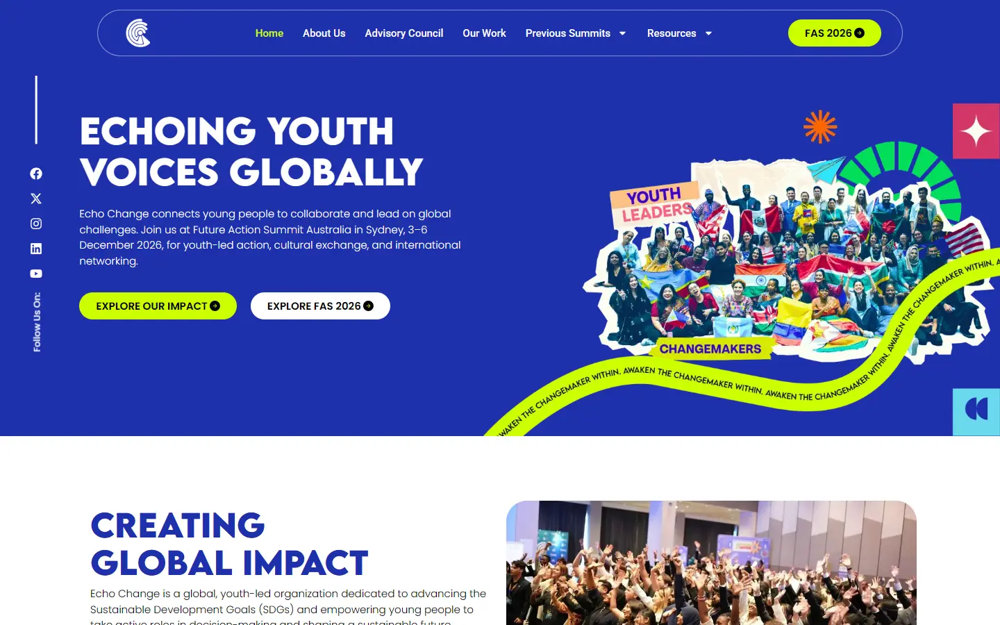
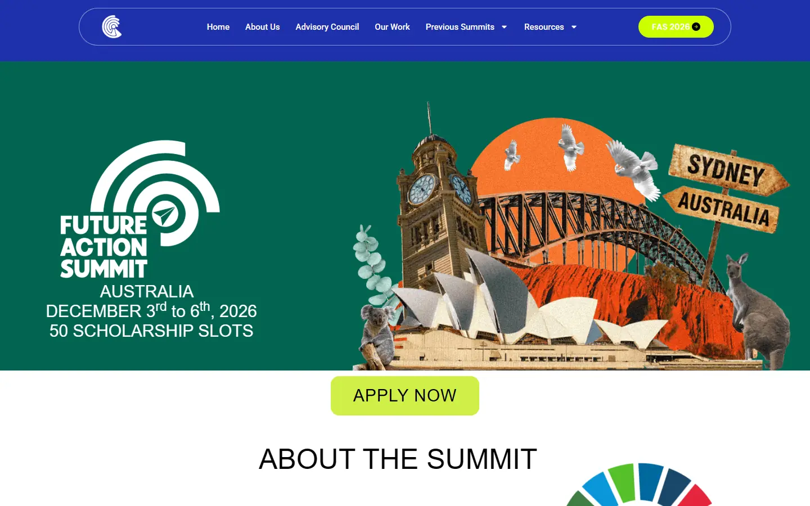
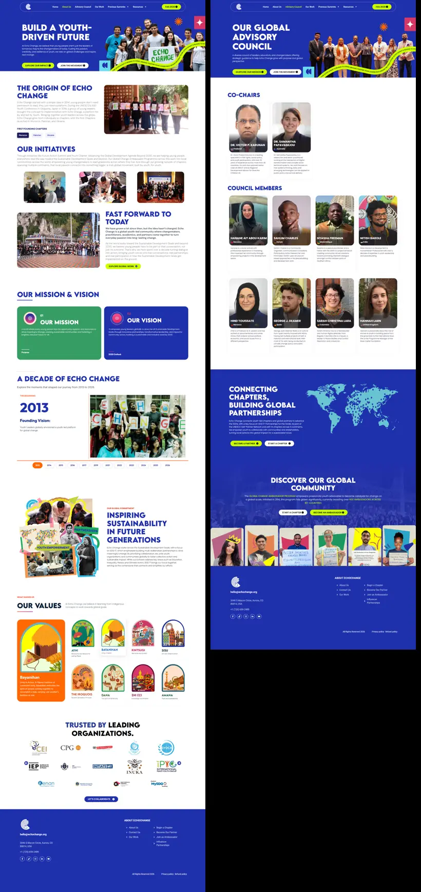

# echochange.org: design and UX teardown

Competitor study for the Global Youth Network (thegyn.org) redesign, SDG Innovation Summit Malaysia (19 to 22 Nov 2026, Kuala Lumpur). Echo Change runs the Future Action Summit (FAS), the closest peer we have: youth SDG summits in Malaysia, Thailand and Australia, scholarship tiers, an ambassador programme and chapters. The client has pointed at this site as the thing to beat, so this file is about what makes it work, what is broken, and how we do better without copying it.

Captured 16 Oct 2026. Screenshots and clips are in [`echochange/`](echochange/). Every number below was measured (computed styles, bounding boxes, network logs, Lighthouse, axe) unless it says "estimated".

## The 10 findings that matter

1. **The pull comes from three moves.** Whole sections in royal blue `#1F30AC` alternating with white (blue is 27% of the desktop home page by pixel count, white 33%), stat and project cards in five different solid colours, and a cut-out crowd collage with sticker labels and a text ribbon. The lime `#CCFF00` accent is only 0.3% of the pixels, yet it marks every primary button. Small amount, big effect.
2. **The hero art is one flat PNG.** The crowd cut-out, the "YOUTH LEADERS" and "CHANGEMAKERS" stickers, the curved "AWAKEN THE CHANGEMAKER WITHIN" ribbon, the starburst, the SDG arc and even the pink sparkle and cyan quote tiles at the right edge are all baked into `Group-1000008323-1--1024x658.png` (800 x 514 natural, shown at 745 x 479). Nothing in it moves, the ribbon text is not real text, it is soft on any 2x screen, and it is the LCP element. Building the same idea as real layers is an easy win.
3. **It is an Elementor kit, and it drifts.** Home H1 is 49px, inner page H1s are 55px. On mobile the stat numbers (40px) are bigger than the H1 (28px). The About page loads seven font families. Section padding jumps between 40, 72, 80, 90 and 100px. Buttons are 39px tall. Most of it looks fine at a glance and falls apart on inspection.
4. **The summit page throws the brand away.** `/fas-australia-december-2026/` switches to green `#016450`, charcoal `#1F1F1F` and orange `#F46F36`. Its heading font ("Kilimanjaro Sans Regular") never loads, so every heading renders in the browser's fallback sans (Arial on Windows). It has no H1, 31 iframes, a countdown stuck at 00 days 00 hours 00 minutes, and a hero that promises "50 scholarship slots" while a banner below says funded applications are closed.
5. **The apply flow is their best piece of UX.** Three clicks from home to a dedicated, nav-free form page that shows the fee (US$800), what it includes, a "Before you begin" checklist and a 2-step progress bar, with Stripe on step 2. The details let it down: binary gender, a DOB label that says DD/MM/YYYY over a mm/dd/yyyy placeholder, a WhatsApp field that defaults to a US number, and no deadline anywhere outside a closed FAQ accordion.
6. **Mobile performance is bad.** Lighthouse 13.5.0 mobile: performance 22 and 26 over two runs, LCP 12.5s and 9.9s, total blocking time 3.06s and 2.04s, CLS about 0.2, 1.9 to 2.2 MB over 264 to 269 requests. SiteGround's bot captcha also intercepts cold visits (it cost 4.4s in the Lighthouse run and blocked plain `curl` and headless Chrome outright).
7. **Accessibility is mediocre.** Lighthouse accessibility 82 to 85. axe flags white on orange stat tiles (2.92:1), the "FAS 2026" header button on the summit page (white on lime, 1.17:1), 120 H2s on the home page for one H1, no `<main>`, auto-generated alt text such as "Portrait of Website Logos New Cei — Echo Change", and a dozen autoplaying carousels with no pause control.
8. **Trust is built by volume, then undercut by sloppiness.** Five stats, 28 partner logos, UNESCO GAP Partner Network, a "UN Secretary General Office" feature, COP22 and COY11 project cards, LinkedIn-linked testimonials. Then the same page says 1,100+ ambassadors in one section and 600 in another, has typos ("Reresenting" twice, "signifcantly"), spells a speaker two ways, hotlinks broken mentor photos from another domain, links PDFs from a staging host, and leaves "#" placeholder CTAs on Our Chapters.
9. **Mobile is a straight stack.** The home page is 13,114px tall at 390px wide (15.5 screens), with 10px section padding, 14px light (300) body text, a 30 x 30 menu button, 53 tap targets under 24px and a header that scrolls away, so the FAS CTA is gone after the first screen.
10. **What GYN should take is the principles, not the look.** One home colour plus one tiny action accent, colour that means something in data tiles, real crowds of real delegates, country chips on every person and project, a poster voice for headlines, a dedicated apply page, and applicant guides as content. Built with GYN's own palette and craft motif, layered real art, and a fast, accessible front end. Section 9 lists what to take and what to stay away from.

---

## How this was gathered

- Python Playwright 1.60 driving installed Chrome, 1440 x 900 (DPR 1) and 390 x 844 (mobile emulation, iPhone UA). Pages were loaded with `wait_until="domcontentloaded"`, then scrolled in 400px steps with 0.8s pauses so lazy images and Elementor entrance animations fire, then measured with `getComputedStyle` and `getBoundingClientRect`.
- SiteGround's "Robot Challenge Screen" blocks plain headless Chrome. It passes when `--disable-blink-features=AutomationControlled` is set and a persistent profile keeps the challenge cookie. Real visitors only see it when SiteGround flags them, so treat the captcha cost in Lighthouse as a cold-visit worst case.
- Full-page screenshots in Playwright resize the viewport and break the Swiper carousels, so full pages were stitched from viewport shots with carousel autoplay stopped. Very occasionally a carousel moved between two frames; I checked each image used here.
- Colour proportions were estimated by snapping every pixel of the stitched screenshots (downsampled 4x) to the nearest palette colour within a distance of 18; anything further is counted as "photo/other".
- Lighthouse 13.5.0 via `npx`, mobile and desktop. axe-core 4.14.0 injected into the page. Own timing measurements with `PerformanceObserver` (LCP, CLS, FCP) and the Resource Timing API.
- Pages visited: home, About Us, Advisory Council, Our Work, Previous Summits, FAS 2026 (`/fas-australia-december-2026/`), Resources, Our Chapters, Join as a Chapter, Blog, one blog post (`/personal-statement-for-conference-application/`), and the three open application forms (self-funded, forum access, invitation letter). There are no individual chapter pages; "Our Chapters" is the chapter page. "Stories" on this site are blog posts and LinkedIn posts.
- Capture artefacts to ignore: the Vimeo embeds on the summit page show "We couldn't verify the security of your connection" in the screenshots. That is Vimeo's bot check reacting to headless Chrome, not a site bug. The site was also being edited during the session (the main menu gained "Our Chapters" as a top-level item between two captures, which made the desktop nav wrap to two rows on the summit page).

---

## 1. First impression: why it reads as young, energetic and credible at once

The first screen ([01](echochange/01-home-desktop-fold.webp)) does five things at once:

- **One loud colour, edge to edge.** The header and hero sit on a single flat royal blue (`#1F30AC`, Elementor global `--e-global-color-5cd9a52`). No gradient, no photo background. Flat saturated colour reads as confident and poster-like, and it photographs well in social shares.
- **A crowd, not a person.** The collage is a group photo of roughly 80 delegates holding national flags (India, Kenya, Zimbabwe, Philippines, US and more are readable). Flags do the "international" job instantly, and a crowd says "people like me go to this". This is the single most persuasive element on the page, and it is real event photography, not stock.
- **Handmade cut-out treatment.** The crowd is cut out with a white, slightly torn paper edge, then dressed with tilted sticker labels ("YOUTH LEADERS" in blue on a peach tag, "CHANGEMAKERS" in blue on a lime tag), a hand-drawn starburst in orange, a paper plane, a green dashed SDG-style arc and a US flag ribbon. It looks like a scrapbook or a zine. That is what makes it read as youthful rather than corporate.
- **A text ribbon that moves through the composition.** A lime band with repeating small caps text curves from bottom left up to the top right edge. It gives direction and pace even though it is static.
- **Poster typography.** "ECHOING YOUTH VOICES GLOBALLY" in Lemon Milk Bold, a wide geometric all-caps display face, 49px with 1.2 line height, white. Next to it the body text is Poppins Light 15px. The contrast between a heavy, wide headline and a thin, round body face is a large part of the "youth brand" signal.
- **Two pill buttons, lime and white.** `EXPLORE OUR IMPACT` (black on lime `#CCFF00`, 17.9:1) and `EXPLORE FAS 2026` (black on white). Pills with a small circled arrow icon. Lime on royal blue is a near-complementary clash that pulls the eye to the buttons immediately.

Why it also feels trustworthy, not just loud:

- The rest of the page is calm. After the hero, most sections are white with blue headings, and the colour shows up in contained cards. The energy is concentrated in a few places.
- Numbers come straight after the hero (1100+, 81+, 2.3K+, 14+, 53K+) with real photos inside the tiles.
- Named people with institutions follow: mentors (UN Human Rights regional office, United Nations Singapore, Institute for Economics & Peace) and an "Intergenerational Advisory Council" with Dr. titles.
- UNESCO GAP Partner Network and SDG 17 are named in body copy, and the gallery has a "UN Secretary General Office feature" tile.

Where the first screen is weak: the hero is short (519px of blue under a 109px header at 1440 x 900), so the white section below shows in the first screen and the composition feels cut off. The headline is generic ("Echoing youth voices globally" is a pun on the name, not a reason to act). The left "Follow Us On:" social rail (rotated -90deg) takes a column for something nobody needs in the first screen.

---

## 2. Visual system

### 2.1 Palette

Elementor kit globals (from the `.elementor-kit-*` rule):

| Token | Hex | Where it is used |
|---|---|---|
| `color-5cd9a52` | `#1F30AC` | The brand blue. Header, hero, three full-bleed home sections, footer, headings on white, secondary buttons |
| `color-secondary` | `#2D4198` | Darker blue for mentor names and some headings ("Stories of Impact", "Trusted by") |
| `color-f3752a6` | `#CCFF00` | Lime. Primary pill buttons, nav hover and active state, highlighted words in paragraphs, gallery tile titles |
| `color-primary` | `#6700EE` | Violet. The "1100+" stat tile, the eyebrow rule above "Testimonials", testimonial role lines |
| `color-5508a13` | `#5B0CE8` | Second violet, barely used |
| `color-bedbb29` | `#FF6702` | Orange. "81+" tile, project cards, header button hover |
| `color-8d6c467` | `#D43765` | Pink/raspberry. "53K+" tile, project cards, hero sparkle tile |
| `color-b9866e7` | `#379D65` | Green. "2.3K+" tile, project cards, hover colour on white buttons |
| (not a token) | `#2CA4C3` | Cyan. "14+" tile, project cards, mentor window bars |
| `color-3564fcf` | `#F8F8F8` | Off-white, barely used |
| (not a token) | `#F3F4FC` | Lavender tint behind the "Future Action Summit" band |
| `color-text` | `#000000` | Body text on white, button text on lime and white |
| `color-f7e6bfc` | `#0F172A` | Slate, barely used |

Estimated share of the page by pixel count (stitched screenshots, see method):

| Page | Main colours |
|---|---|
| Home, desktop | white 33.4%, blue `#1F30AC` 27.1%, photos and other 26.2%, tint `#F3F4FC` 5.5%, green 1.0%, cyan 0.9%, orange 0.8%, pink 0.6%, lime 0.3% |
| Home, 390px | photos and other 38.2%, white 26.1%, blue 20.4%, green 2.6%, cyan 1.4%, orange 1.2%, pink 0.7%, violet 0.6%, lime 0.5% |
| FAS 2026, desktop | green `#016450` 23.7%, photos 21.4%, white 18.6%, charcoal `#1F1F1F` 18.2%, black 10.5%, blue 4.6% (header and footer only), orange `#F46F36` 1.1%, lime `#CFEF48` 0.3% |

So the home page is roughly "one third white, one quarter blue, one quarter photos", with the five card colours together under 5% and the lime under 1%. The summit page is a different site: green, charcoal and black, with a second, slightly different lime (`#CFEF48`) and orange (`#F46F36`).

Contrast of the main pairs (WCAG ratio, measured from the hex values):

| Pair | Ratio | Verdict |
|---|---|---|
| White on blue `#1F30AC` | 10.11 | Pass |
| Lime `#CCFF00` on blue | 8.61 | Pass |
| Black on lime | 17.87 | Pass |
| White on violet `#6700EE` | 7.47 | Pass |
| White on pink `#D43765` | 4.63 | Pass for body text, just |
| White on green `#379D65` | 3.40 | Large text only. Fails for the 15px tile copy |
| White on cyan `#2CA4C3` | 2.91 | Fails |
| White on orange `#FF6702` | 2.92 | Fails (axe flags the "81+" tile) |
| White on lime (FAS page header button) | 1.18 | Fails badly |
| Lime on white (if ever used) | 1.18 | Fails |

### 2.2 Typefaces

Home page loads: Lemon Milk (bold), Poppins 300/400/500/600/700, Inter 400/800, Roboto 400/500/700. The About page adds DM Sans, Outfit and Plus Jakarta Sans (seven families on one page). The summit page asks for "Kilimanjaro Sans Regular" and "ROBOTO BOLD" as family names; Kilimanjaro never loads and falls back to the default sans. The blog uses a different self-hosted copy called "echo lemon milk".

- **Lemon Milk Bold** is the display face. It is an all-caps design (the lowercase glyphs are small caps), wide, geometric, with flat terminals. `text-transform` is `none` in CSS; the caps come from the font. Letter spacing is `normal` everywhere.
- **Poppins** is the body and button face, mostly at weight 300 (Light) for paragraphs, which looks elegant on a big desktop screen and thin and grey on a phone.
- **Inter** only appears in the gallery tile captions. **Roboto** only in the footer and mobile menu. Neither has a reason to be there.

### 2.3 Type scale (desktop 1440, home unless noted)

| Role | Face | Size / line height | Weight | Case | Colour | Example |
|---|---|---|---|---|---|---|
| H1 (home) | Lemon Milk | 49 / 58.8 | 700 | caps by font | white | "Echoing Youth Voices Globally" |
| H1 (inner pages) | Lemon Milk | 55 | 700 | caps by font | white | About, Advisory, Our Work, Previous Summits, Chapters, Blog |
| H2 large | Lemon Milk | 57 / 68.4 | 700 | caps by font | black + `#2D4198` two-tone | "Stories of Impact" |
| H2 section | Lemon Milk | 45 / 54 (46 / 55.2 on the blue partnership section) | 700 | caps by font | `#1F30AC` on white, white on blue | "Creating Global Impact", "Meet our Mentors" |
| Stat number | Lemon Milk (as H2) | 40 / 48 | 700 | | white | "1100+", "53K+" |
| H2 mid | Lemon Milk | 34 / 42 | 700 | | `#1F30AC` | "Future Action Summit" band |
| H2 small | Lemon Milk | 32 / 38.4 | 700 | | `#1F30AC` | "Our Intergenerational Advisory Council" |
| Card title | Lemon Milk | 22 / 26.4 | 700 | | `#231F20` | testimonial names |
| Card title | Lemon Milk | 12 / 22 | 700 | | white | project card titles (very small for a title) |
| Person name | Poppins | 20 / 24 | 700 | uppercase | white | advisory cards |
| Person name | Poppins | 16 / 19.2 + 15 / 15 | 700 + 400 | uppercase | `#2D4198` | mentor first name (H2) + surname (H3) |
| Gallery caption | Inter | 18 / 21.6, then 20 / 24 at 800, then 15 / 18 | 400 / 800 / 400 | title uppercase | white, lime title | gallery tiles |
| Body (hero) | Poppins | 15 / 22.5 | 300 | none | white | |
| Body (tiles) | Poppins | 15 / 18 to 19.5 | 300 | none | white | stat tile copy |
| Body (testimonial) | Poppins | 14 / 21 | 300 | none | `#231F20` | |
| Event line | Poppins | 16 / 24 | 500 | none | `#1F30AC` | "Sydney, Australia · 3–6 December 2026" |
| Button | Poppins | 15 / 600 (16 on some) | 600 | uppercase | black or white | `.elementor-button` |
| Tab label | Poppins | 16 | 700 | uppercase | `#1F30AC`, inactive at 25% alpha | previous summits list |
| Eyebrow | Poppins | ~13 | 600 | uppercase | `#2D4198` with a 55px violet rule | "TESTIMONIALS" |
| Footer heading | Roboto | 18 / 18 | 700 | uppercase | white | "ABOUT ECHOCHANGE" (an H4 with no H3 above it) |

There is no ratio behind this. Section H2s sit at 32, 34, 45, 46 and 57px on one page. Card titles go from 12px to 22px. The weight never changes for display text (always 700), so size is the only lever, and it is used loosely.

Mobile (390): H1 28 / 33.6, section H2 24 to 30, stat numbers stay at 40 (bigger than the H1), body 14 / 21 at weight 300, buttons 15px in a 39px-tall pill, header button 12px in a 32px pill.

Summit page: headings are set at 30 to 60px in weight 100 to 300 of a font that does not load, so they render as Arial at regular weight. "OUR GLOBAL MENTORS" is 60px with a 46px line height (tighter than the font size).

### 2.4 Spacing, grid, container

- Boxed container: `.e-con-boxed > .e-con-inner` with `max-width: min(100%, 1200px)`, so 120px side margins at 1440. The header bar is narrower, 1160px wide (140px margins). The FAS band is a 760px column.
- Columns are flex rows, not a grid. Typical gaps are 18px and 20px; the project and mentor carousels use 10px between items.
- Vertical rhythm on the home page, inner padding top and bottom: hero 40 / 0, impact 90, partnerships 100, previous summits 90, FAS band 40, mentors 90, projects 72 (outer), advisory 80, gallery and stories set by children. So there are five different section paddings on one page, and the FAS band (40) visibly breaks the rhythm.
- Section heights at 1440: hero 519, impact 756, partnerships 635, previous summits 707, FAS band 651, mentors 766, projects 742, advisory 730, gallery 1,380, stories 800, partners 670, community CTA 403, footer 581. Total 9,447px.
- Mobile: sections use 10px left and right padding (content lands 20 to 30px from the edge depending on the widget). Section tops are 24 to 50px.

### 2.5 Radius, borders, shadows

- Radius counts on the home page (visible elements): 16px x66, 24px x59, 50% x34 (round icons and dots), `16px 16px 0 0` x23 (photo tops on cards), 75px x16 (pill buttons and the header pill), 38px x15, 30px on the FAS band button and some panels.
- Borders: mostly `1px #ECEFF8` on light cards, `1px rgba(103,0,238,0.15)` on testimonial cards, `1px` white at partial opacity around the header pill, `1px rgba(31,48,172,0.75)` under the summit tabs.
- Shadows: almost none. `0 0 10px rgba(31,48,172,0.05)` on 18 cards (invisible in practice), `0 6px 22px rgba(0,0,0,0.35)` on 3 elements, and the dropdown menu uses `0 18px 44px rgba(16,22,92,0.18)`. Depth comes from colour, not shadow. That is part of why it reads as flat and graphic.

### 2.6 Iconography

- Font Awesome SVGs inlined by Elementor (`e-font-icon-svg e-fas-*`), used for the caret on dropdowns, the circled right arrow inside every button, the map pin on mentor cards, and social icons.
- A handful of flat white illustrated icons in the stat tiles (two hands holding a heart, a star with a pointing hand, a star on a badge). Generic stock icon style.
- Flag PNGs (13 to 18px) on project chips and advisory cards, some named with raw emoji characters in the file name (`%F0%9F%87%AC%F0%9F%87%A7.png`).
- A paper-plane doodle used as a recurring motif (FAS logo, mentor cards, previous-summit active tab marker).
- The summit page has its own orange circular icons (calendar, map pin, envelope) and a full-colour SDG wheel.

### 2.7 Imagery style and treatment

- **Event photography, lots of it.** Group shots at summit backdrops, delegates with flags, people on stage, workshop tables. Mostly 2560px "-scaled" WordPress originals. Colour is natural, no grading, no duotone. Quality varies from professional (`DSC0xxxx`, `HAS_xxxx`, `99A9xxx` series) to phone shots and a Zoom screenshot used as a project card image.
- **Cut-outs with paper edges** in every hero (home, About, Advisory, Our Work, Previous Summits, Chapters, Resources, Blog): a group photo or a cluster of portraits cut out with a white torn edge, plus the same ribbon, starburst, sparkle tile and quote tile. Each hero is a separate flattened image, so the "kit" is consistent but nothing in it is live.
- **Masked portraits.** Mentor portraits are background-removed cut-outs placed inside a fake browser window (a coloured top bar with three dots, matching one of the card colours) and the head breaks out above the window frame. Testimonial portraits sit on a lime organic blob. Advisory portraits are plain rectangular crops with a dark bottom gradient for the name.
- **Illustration** appears on About (an "Our Values" set of arch-shaped illustrations for Ayni, Bayanihan, Kintsugi, Sisu and others) and on the Chapters hero (a stack of report covers as stickers). These are the most original images on the site.
- **No duotone, no grain, no 3D.** The only "effect" is the cut-out and the sticker layer.

---

## 3. Layout anatomy

### 3.1 Home page, section by section (desktop 1440)

| # | Section (Elementor `data-id`) | Layout and content | CTA | Good | Weak |
|---|---|---|---|---|---|
| 0 | Header (`elementor-166`) | Pill-shaped bar, 1160px wide, 1px light outline on blue. Logo left, 6 nav items centre (two dropdowns), lime "FAS 2026" pill right. Height 109px. `position: static` | FAS 2026 | One clear always-visible event CTA | Not sticky, so the CTA scrolls away. Dropdown carets add noise |
| 1 | Hero (`0f57415`) | Left: rotated social rail, H1, 4-line paragraph, two pills. Right: 745px flattened collage PNG bleeding off the right edge | Explore our impact / Explore FAS 2026 | Real crowd, colour, energy | Short (519px), generic headline, both CTAs say "Explore", the event CTA is second and white |
| 2 | Creating Global Impact (`1efd465`) | Two columns. Left: H2, paragraph, blue pill, then two stat tiles (violet 1100+, orange 81+). Right: big green 2.3K+ tile with a crowd photo, then cyan 14+ and pink 53K+. Staggered heights, 24px radius, photo on top of each tile ([02](echochange/02-home-desktop-impact.webp)) | Explore our story | Data as colour blocks; feels like a bento poster | Stat colours have no meaning; white on orange and cyan fails contrast; icons are generic |
| 3 | Fostering Communities (`964aed6`) | Blue section. Left: H2 (slides in from the right, 2s), paragraph naming SDG 17 and UNESCO GAP, lime and white pills. Right: cyan world map SVG with dark pins ([03](echochange/03-home-desktop-partnerships-map.webp)) | Become a partner / Start a chapter | Quick geographic proof | Map is decorative (pins are not clickable, no chapter names); copy is long |
| 4 | Our Previous Summits (`08ec412`) | Left: 5 tabs (Elementor nested tabs) listing each FAS edition with date, inactive tabs at 25% alpha. Right: Vimeo video (600 x 337) with a custom round play button, then a strip of 3 thumbnails that crawls sideways ([04](echochange/04-home-desktop-previous-summits.webp)) | Read more | Track record as a clickable list | Inactive tabs fail contrast; the "Read more" sits alone at the bottom next to a stray rule |
| 5 | Future Action Summit band (`28ff86e`) | Lavender tint, centred 760px column: H2 34px, "Sydney, Australia · 3–6 December 2026", a different-style button (`#2D2DAB`, 30px radius, sentence case, no icon), group photo at the Sydney Opera House ([05](echochange/05-home-desktop-fas-band.webp)) | Explore FAS & Apply | The only place on home that says "Apply" | Looks bolted on: different button, different padding (40px), placed in the middle of the page instead of near the top |
| 6 | Meet our Mentors (`47bc654`) | Loop carousel, 4 cards visible, arrows outside. Card: coloured window bar, cut-out portrait breaking out of the top, paper plane doodle, name split across H2 and H3, tiny organisation line, pin + country ([06](echochange/06-home-desktop-mentors.webp)) | none | The pop-out portrait is the most distinctive card on the site | Org text is ~9px; card markup is the heaviest on the page; no link to a mentor page |
| 7 | Where Purpose Meets Action (`a5fc0d3`) | Blue section, H2 left, white "View more" pill right. Carousel of 15 project cards (4 visible), photo on top, white country chip with flag, Lemon Milk 12px title, Poppins body, card colour rotates pink/orange/cyan/green ([07](echochange/07-home-desktop-purpose-cards.webp)) | View more | Real projects with places (Ghana, Pakistan, Morocco, Ukraine, Nepal) | Card colour is random; 12px titles; one image is a Zoom screenshot |
| 8 | Advisory Council (`538b22c`) | Left column text + "View more". Right: carousel bleeding off the right edge, 3 visible, slow drift. Photo card with dark gradient, name, flag, bio below ([08](echochange/08-home-desktop-advisory.webp)) | View more | Bleed-off carousel signals "there is more" | The H2 overflows its column ("INTERGENERATIONAL" runs into the first card at 1440) |
| 9 | Our Digital Gallery (`1f4d395`) | Blue, centred H2, 3-row bento of 8 tiles mixing Vimeo videos and photos with captions (label, lime title, sub line) ([09](echochange/09-home-desktop-gallery.webp)) | none | Bento rhythm with mixed sizes is lively | Captions sit on busy photos with no scrim; the play button covers the video's own title text; "Reresenting" typo twice; tiles load late and show as empty navy boxes while scrolling (see the desktop clip) |
| 10 | Stories of Impact (`c8e74bf`) | Eyebrow "TESTIMONIALS", two-tone 57px H2, subline. Left: one-at-a-time testimonial carousel with 13 dots. Right: video testimonial carousel with 13 dots ([10](echochange/10-home-desktop-stories.webp)) | none | Each quote has the edition and funding status ("FAS Thailand '25 - Partially Funded Delegate") and links to the person's LinkedIn post | The right half is an empty white area with a faint play icon until the poster loads; the "Play" links open PNG files on a staging host (`aamern27.sg-host.com`), not videos |
| 11 | Trusted by leading organizations (`6240174`) | Two-tone H2, 3 rows of logos in a 2-slide carousel (28 logos), arrows overlap the logos ([11](echochange/11-home-desktop-partners.webp)) | Let's collaborate | Many logos | The first slide is mostly small organisations; UNESCO, USIP, Open Society, Theirworld and COP22 are on the second slide behind an arrow. Logos are 950px PNGs shown at about 120px; alt text is auto-generated |
| 12 | Discover our global community (`f426ae7`) | Full-bleed crowd photo under a blue overlay, centred H2, paragraph with lime highlights, white and lime pills ([12](echochange/12-home-desktop-discover-footer.webp)) | Start a chapter / Become an ambassador | Good closing CTA for the ambassador programme | No fallback background colour: white text sits on white until the photo loads. Says "600 ambassadors", contradicting "1100+" in section 2 |
| 13 | Footer (`elementor-236`) | Blue. Logo, email, US address (Aurora, CO), phone, social circles; two link columns; legal links | none | Clear contact | Roboto here, Poppins everywhere else; no newsletter, no event dates |

Full-page overview: [13](echochange/13-home-desktop-full-overview.webp).

Overall rhythm: white, blue, white, tint, white, blue, white, blue, white, white, photo, blue. It alternates well in the top half and then loses its pattern. The page has no single main path: there are 13 buttons on the home page (plus 5 tabs), and only one of them says "Apply".

### 3.2 Summit page, `/fas-australia-december-2026/` (desktop 1440, 13,628px tall)

| # | Section | What it is | Notes |
|---|---|---|---|
| 1 | Hero (`75b0ec0d`) | Green `#016450`. FAS logo (white arcs and a paper plane), "AUSTRALIA / DECEMBER 3rd to 6th, 2026 / 50 SCHOLARSHIP SLOTS" in fallback Arial, and a big collage of Sydney landmarks (Opera House, Harbour Bridge, Uluru, Central Station clock tower, kangaroo, koala, cockatoos, a "SYDNEY / AUSTRALIA" signpost) on an orange sun | The collage is strong and specific to the city. The background image is served from `beta.echochange.org`. The type next to it looks unfinished |
| 2 | Apply now | A lime `#CFEF48` button, 70px tall, 15px radius, 30px text, on white, centred | Jumps to `#participation`, about 3,600px further down |
| 3 | About the summit | Plain Arial "ABOUT THE SUMMIT", theme line, paragraph, full SDG wheel (rotates on scroll via Elementor Motion Effects, `motion_fx_rotateZ_effect` on image `37c5c1fe`) ([19](echochange/19-fas26-desktop-about-eligibility.webp)) | |
| 4 | Closed notice + countdown | Black bar: "Fully & partially funded applications are now closed. You can still apply for Self-Funded, Forum Access, or an Invitation Letter." Then a green pill countdown showing 00 / 00 / 00 | The countdown has already run out but stays on the page |
| 5 | Who should attend | Charcoal panel with a bullet list, photo beside it | |
| 6 | Key features | Green panel, rounded top-left, centred paragraph with bold phrases | |
| 7 | Event facts | Three grey cards with orange icons: date, location, email (`hello@futureactionsummit.org`, a different domain from the rest of the site) | |
| 8 | Eligibility and selection | Two charcoal-and-green panels side by side | Age 16 to 45, up to 55 for self-funded and forum access; no English test |
| 9 | Benefits | Charcoal panel with a green list ("170 total slots: 20 Fully Funded, 30 Partially Funded & 120 Self-Funded") and a speaker photo | The slot numbers are useful and buried |
| 10 | Participation categories | The pricing section ([20](echochange/20-fas26-desktop-pricing-tiers.webp)). Four green cards on charcoal, alternating photo left and right: Fully & Partially Funded US$19.99 application fee (button greyed "APPLICATIONS CLOSED"), Self Funded (Confirmed Slot) US$800, Forum Access US$600, Invitation Letter US$99.99. Each lists inclusions with check icons and an orange "Apply now" button | Cards drift vertically with scroll (Motion Effects `translateY`). Clear inclusions per tier. 12px list text |
| 11 | What will happen / focus areas / objectives | Three more text panels with photos ([21](echochange/21-fas26-desktop-mentors-highlights.webp)) | Repetitive. Same panel pattern four times |
| 12 | Our global mentors | 8 portrait slots with orange country chips | 6 of 8 portraits are broken: hotlinked from `futureactionsummit.org`, which runs the same SiteGround captcha, so the images fail. "Read more" leaves for `futureactionsummit.org/mentors/` |
| 13 | Previous event highlights | Per edition: a Vimeo video and a photo carousel, with orange date banners in wide letter-spaced Roboto Black | |
| 14 | Voices from the summit | 2 rows of 4 square Vimeo embeds in a carousel (24 embeds in the DOM including Swiper duplicates) ([22](echochange/22-fas26-desktop-voices-faq.webp)) | 31 iframes on the page in total |
| 15 | FAQ | 11 black pill accordion rows (Unlimited Elements accordion) including "What is the application deadline?" | The deadline answer is hidden inside a closed accordion |
| 16 | Footer | The Echo Change blue footer | The only blue on the page apart from the header |

Verdict: this page holds everything an applicant needs (dates, who, eligibility, selection, slots, four priced tiers, FAQ) but in a template that looks like a different, older site. No H1, fallback fonts, a dead countdown, broken mentor images, and a pricing section that starts 4,266px down the page.

### 3.3 Inner pages, quickly

- **About** ([28](echochange/28-inner-about-advisory.webp), left): hero kit, origin story with founding chapter tags (Morocco, Pakistan, Ukraine), initiatives photo row, mission and vision as a green and a blue card, a 2013 to 2026 timeline with year pills, a collage illustration "Inspiring sustainability in future generations", and the Values illustrations (the best artwork on the site).
- **Advisory Council** (right): co-chairs, then a 4-column grid of 8 council members with photo, flag and short bio. Then the same map section and the same ambassador CTA as home.
- **Our Work, Previous Summits, Our Chapters** ([29](echochange/29-inner-ourwork-previous-chapters.webp)): Our Work repeats home sections. Previous Summits is a zigzag of edition cards with orange and blue fact chips (date, location, nationalities, delegates), then a cyan "Be part of the next summit" band with cut-out speakers. Our Chapters has a colour-blocked 2 x 2 "Why start a local chapter" grid and a strip of portraits on coloured backgrounds; four of its CTAs (`Explore our impact`, `Join the movement`, `Become an ambassador`, `Start a chapter`) point to `#`.
- **Resources, Blog, story post, Join as a Chapter** ([30](echochange/30-inner-resources-blog-story-joinchapter.webp)): Resources has four cards, two "Download (PDF, 24MB)" links that point to the staging host, and a "Coming soon" card. The blog has three posts, all "Uncategorized", all with the same hero collage as thumbnail, all applicant guides (personal statement, visa invitation letter, motivation letter). The post page has a sticky table of contents, an FAQ and an author box. The blog hero image alt text reads "Generation Shift Forum community of young...", a name that has nothing to do with Echo Change, which suggests the template was reused from another project. Join as a Chapter has a long two-column form with Individual and Organization tabs.

---

## 4. Motion and interaction

Clips (recorded at 1440 x 900 and 390 x 844 with Playwright `record_video`, constant-speed scroll, re-encoded at 2x speed):

- [`video-home-desktop-1440x900-2x.webm`](echochange/video-home-desktop-1440x900-2x.webm) (29s, 1.6 MB)
- [`video-home-mobile-390x844-2x.webm`](echochange/video-home-mobile-390x844-2x.webm) (28s, 1.5 MB)
- [`video-fas26-desktop-1440x900-2x.webm`](echochange/video-fas26-desktop-1440x900-2x.webm) (25s, 1.5 MB)

What moves, with measured values:

| Element | Mechanism | Timing |
|---|---|---|
| Section headings (hero H1, "Creating Global Impact", "Stories of Impact", "Our Digital Gallery", "organizations.") | Elementor entrance animation `fadeInUp`, class `animated-slow` | 2s, `ease`, once. Hero H1 has a 240ms delay |
| "Fostering Communities..." H2 | `fadeInRight` | 2s, `ease` |
| Advisory H2 | `fadeInLeft` | 2s, `ease` |
| All pill buttons with an arrow (9 on home) | `elementor-animation-float` on hover: `translateY(-8px)` | `transform 0.3s ease-out`; background also darkens (lime `#CCFF00` to `#BBE809`, white buttons to green `#379D65`) |
| Nav links | Colour change on hover, white to lime `#CCFF00` | 0.4s |
| Dropdown (Previous Summits, Resources) | White panel, 16px radius, `0 18px 44px rgba(16,22,92,0.18)`, 296px wide ([14](echochange/14-home-desktop-submenu.webp)) | Appears on hover |
| Mentor carousel (`ae68b96`) | Swiper loop carousel, 4 per view (2 tablet, 1 mobile), autoplay, pause on hover and on interaction | Advances every 5s, slide 0.5s `ease` (sampled `transform` every 0.5s: steps of about 300px every 5.5s) |
| Project cards (`c1a227d`) | Same, 4 per view | Every 3.5s, 0.5s slide |
| Advisory carousel (`ba998d2`) | 3 per view, autoplay with `speed: 3000` and `autoplay_speed: 3000` | A slow 3s slide every 3s, so it looks like a continuous drift with a hitch |
| Summit thumbnails under the video (`a7f3182` and 4 more) | Image carousel with `autoplay_speed: 1` and `speed: 4000` (a marquee made from Swiper) | 4s per step with `ease` timing, so it surges and slows every 4s instead of crawling evenly |
| Testimonials (`e233196`) | 1 per view, 13 dots | Every 5s, 1.5s slide |
| Video testimonials (`1d0916f`) | Media carousel, loop | Every 3s, 1.5s slide |
| Partner logos (`99d3f31`) | Nested carousel | Every 5s, 1.5s slide |
| Previous summits tabs | Elementor nested tabs; clicking swaps the video and thumbnails | Instant swap, no transition |
| Videos | Vimeo iframes, `controls=0`, custom round play button | Click to play, no autoplay |
| Summit page | Motion Effects: SDG wheel `rotateZ` on scroll; pricing cards `translateY` on scroll (parallax drift) | Scroll-linked |
| Page | `html { scroll-behavior: smooth }` | |

What does not move: the hero collage, the ribbon (it looks like it should scroll like a marquee and it does not), the stickers, the map pins, the stat numbers (no count-up), the cards (no hover state on any card, only buttons, tabs, carousel arrows, nav and footer links have `:hover` rules).

Reduced motion: the CSS has two `prefers-reduced-motion` rules, both from Elementor core. The 12 autoplaying carousels in the markup (5 are the per-tab thumbnail strips, so 7 or 8 run on screen) are configured in `data-settings` JSON and I found nothing that turns them off for reduced-motion users. There is no pause button on any carousel.

Keyboard: the first Tab stops on "Home" with the browser default focus ring (`outline: auto 1px`) ([31](echochange/31-home-desktop-keyboard-focus.webp)). Hover and focus share the same rules on buttons, which is fine. The skip link exists but its target `#content` does not (axe `skip-link`).

Overall: the motion budget is small and mostly Elementor presets. The 2s fades are slow and make headings arrive late. The site feels lively mainly because of colour and carousels, not because of considered motion.

---

## 5. Information architecture and conversion

### 5.1 Navigation

At capture time: Home, About Us, Advisory Council, Our Work, Previous Summits (dropdown: five past editions), Resources (dropdown: Resource Hub, Affiliates, and on desktop also Our Chapters and Blog) and the lime "FAS 2026" button. During the session "Our Chapters" was moved to the top level, which wrapped the desktop nav to two rows on the summit page. On mobile the hamburger opens a plain white list with every submenu expanded, in Roboto, with no CTA inside ([17](echochange/17-home-mobile-menu-open.webp)).

Problems: "Home" is a nav item. The current event is a button, not part of the structure, and past events are a dropdown of five dated items, so the menu will keep growing with every edition. There is no "Apply" in the nav. "Affiliates" (an AffiliateWP influencer sign-up) sits next to the resource hub.

### 5.2 Path to apply

From the home page:

1. `EXPLORE FAS 2026` (hero) or `FAS 2026` (header) opens the summit page.
2. `APPLY NOW` under the summit hero scrolls to `#participation` (about 3,600px).
3. `APPLY NOW` on a tier card opens a separate form page, for example `/fas-self-funded-application/`.
4. Form step 1 of 2: 15 fields (11 required) plus a terms checkbox, then `Continue to Next Step →`.
5. Step 2: the fee as a fixed radio item ("Application Fee - $800.00") and a Stripe card element. I stopped here and did not submit anything.

So: 3 clicks plus one long scroll to reach the form, then 2 form steps. The form page itself ([25](echochange/25-apply-self-funded-desktop.webp), [26](echochange/26-apply-step2-payment-desktop.webp), mobile [27](echochange/27-apply-self-funded-mobile.webp)) is the best page on the site:

- No main nav, only "← Back to Future Action Summit Australia". Green header with an eyebrow ("AUSTRALIA 2026 · CONFIRMED PARTICIPATION"), a clear H1 ("Self-Funded Application"), three fact chips (dates, city, "Registration while places remain"), the fee in large type ("DELEGATE FEE US$800") and a 4-item inclusions list (with "Airfare and transfers not included").
- A "Before you begin" card: use your passport name, have a JPG or PNG headshot ready, you arrange your own airfare, read the refund and visa terms.
- Fields grouped under tinted section bars with a lime left rule: Personal, Contact, Education, Other.

Form problems:

- Gender is a select with only Male and Female.
- "Date of Birth (DD/MM/YYYY)" label over a `mm/dd/yyyy` placeholder. And it asks for Age as well, which can be calculated.
- WhatsApp number field defaults to a US flag and a `(201) 555-0123` placeholder, while the phone field shows `+61 4xx xxx xxx`.
- The step 2 "Back to Details" button is the default WPForms blue, off brand.
- The progress bar has no accessible name (axe `aria-progressbar-name`), and the file help text is `#747D98` on white at 13px (4.09:1).
- The WPForms Form Abandonment add-on is active (`wpforms-form-abandonment.min.js`, container class `wpforms-form-abandonment`), which saves partially typed entries before the person presses submit. That is a privacy point worth making when we pitch a cleaner flow. (I did not type anything into the form for this reason.)
- The three open forms (self-funded, forum access, invitation letter) are the same 15 fields. Only the fee changes.

### 5.3 Prices, scholarships, deadlines

- No price appears on the home page. The four tiers and amounts are only on the summit page, 4,266px down: US$19.99 application fee for fully and partially funded (closed), US$800 self-funded, US$600 forum access, US$99.99 invitation letter that can be credited toward a higher tier.
- Scholarship status is contradictory: the hero says "50 SCHOLARSHIP SLOTS", the bar below says funded applications are closed, the funded card shows a greyed "Applications closed" button.
- The slot split (20 fully funded, 30 partially funded, 120 self-funded) is a bullet inside the Benefits list.
- No deadline date is visible. The countdown shows zeros. "What is the application deadline?" is a closed FAQ item at the bottom.

### 5.4 Trust signals and social proof

- **Numbers:** 1100+ Global Change Ambassadors, 81+ countries, 2.3K+ youth participants, 14+ chapters, 53K+ lives impacted (home). "600 ambassadors across 81+ countries" (same home page, bottom).
- **Institutions:** UNESCO GAP Partner Network and SDG 17 in body copy; "UN Secretary General Office feature" on a gallery tile; project cards for COP22 and COY11 in Morocco, UNESCO Draw Disability, Theirworld Up for School.
- **Logos:** 28 partner logos over two carousel slides. The first slide, which is what most visitors see, is mostly small or regional organisations (CEI, CPG, Global Education First Initiative, IEP, Kenan Foundation Asia, Mahidol University International College, MasterPeace Romania, MySDG Academy, INUKA, IPYG, GYDCA, Initiate MY, Wolfiz Technologies). The heavier names (UNESCO, USIP, Open Society, Theirworld, COP22) are on the second slide, behind an arrow.
- **People:** mentors with organisation and country, an advisory council with Dr. titles and former UNICEF and Save the Children roles, testimonials with edition and funding status, each linked to the person's own LinkedIn post (verifiable, which is smart).
- **Track record:** five past editions in the nav and in a tabbed list with video.

### 5.5 Urgency devices

A countdown (dead), a "closed" bar, "Registration while places remain" on the form page, and "Confirmed slot" wording on the self-funded tier. No dated deadline, no "X places left", no early-bird date.

### 5.6 Forms elsewhere

Join as a Chapter is a long WPForms form with Individual and Organization tabs. Partner, ambassador and affiliate sign-ups have their own pages. All of them are WPForms with the same default field styling.

---

## 6. Mobile (390 x 844)

Overview: [15](echochange/15-home-mobile-overview-a.webp), [16](echochange/16-home-mobile-overview-b.webp); summit page [23](echochange/23-fas26-mobile-overview-a.webp), [24](echochange/24-fas26-mobile-overview-b.webp).

| Section | How it adapts | Problems |
|---|---|---|
| Header | Lime square hamburger left, logo centre, lime "FAS 2026" pill right inside a full-width outlined pill | Toggle is 30 x 30px. Header is not sticky |
| Hero | Text first, two pills stacked, then the collage scaled to 370px wide | The H1 is 28px. The collage becomes small and its ribbon text unreadable. The hero is 699px tall, so the collage lands at the bottom of the first screen |
| Impact stats | Tiles stack one per row, each with its photo | 2,006px for five numbers. The numbers (40px) are now the biggest text on the page |
| Partnerships | Text then map | 604px of mostly map |
| Previous summits | The tab list becomes a stack, video and thumbnails below the first tab | |
| FAS band | Centred, button, photo | Fine |
| Mentors | 1 card per view, arrows over the card edges | Org text tiny |
| Projects, advisory | 1 card per view | Fine but long |
| Gallery | Every tile full width, stacked | 3,007px of gallery. The longest section on the phone |
| Stories | Testimonial card, then a large white video area with a faint play icon | About 450px of blank white while the video poster loads |
| Partners | Logo grid shrinks to about 40px-wide logos | Unreadable |
| Footer | Single column | Fine |

Measured on the mobile home page: 13,114px total height, 10px section side padding, body text 14px at weight 300, 18 text elements under 12px, 53 links or buttons smaller than 24 x 24px, no horizontal overflow (`scrollWidth` 390). The summit page is 17,575px tall on mobile; its heading fallback font looks even rougher at small size, the email address wraps mid-word ("futureactionsummit.or / g"), and the eligibility panel text runs to the right edge of its card.

The apply form on mobile is fine: single column, full-width fields, fee and inclusions above the form.

---

## 7. Performance and quality

### 7.1 Lighthouse 13.5.0, home page

| Run | Perf | A11y | Best practices | SEO | FCP | LCP | TBT | CLS | Speed Index | Weight | Requests |
|---|---|---|---|---|---|---|---|---|---|---|---|
| Mobile, cold profile | 22 | 82 | 96 | 77 | 3.8s | 12.5s | 3,060ms | 0.201 | 7.2s | 1,894 KiB | 264 |
| Mobile, second run | 26 | 85 | 73 | 77 | 3.7s | 9.9s | 2,040ms | 0.192 | 6.1s | 2,175 KiB | 269 |
| Desktop | n/a | 85 | 100 | 77 | | | | 0.102 | | | |

Both mobile runs went through the SiteGround captcha first (4 redirects; Lighthouse attributes 4.4s of wasted time to them), so FCP and LCP include that. Even taking it out, LCP is 5.5 to 8s and TBT 2 to 3s on a mid-range phone profile. Desktop Lighthouse failed to produce performance numbers in four attempts (twice it scored the captcha page itself, twice the trace engine reported "missing metric scores" after the page loaded). Desktop numbers below are my own.

Mobile run 1, by type: images 162 requests / 1,084 KiB, scripts 45 / 459 KiB, stylesheets 36 / 57 KiB, fonts 11 / 218 KiB. Biggest single files: `DSC03811-scaled.jpg` 355 KiB, `DSC04668-scaled.jpg` 191 KiB, Google Tag Manager 191 KiB, a 162 KiB script bundle, `DSC04275-scaled.jpg` 154 KiB, Meta's `fbevents.js` 114 KiB. Third parties: Google Tag Manager and Analytics (`G-S61R6M8FSS`), Google Ads (doubleclick), Meta pixel, Vimeo. PixelYourSite also carries TikTok consent settings, but no TikTok pixel request showed up.

Lighthouse failures worth noting: layout shifts (4 found), unsized images, images served at low resolution, unused JavaScript (174 KiB), no meta description, invalid robots.txt, links without descriptive text, page prevented back/forward cache.

### 7.2 Own measurements (Playwright, warm profile so no captcha)

| Case | TTFB | FCP | LCP | LCP element | CLS | Requests | Transferred | DOM elements |
|---|---|---|---|---|---|---|---|---|
| Home, desktop, unthrottled | 685ms | 0.83s | 1.43s | hero collage PNG | 0.22 | 243 | (cached) | 3,168 |
| Home, 390px, slow 4G (150ms RTT, 1.6 Mbps) + 4x CPU | 714ms | 1.88s | 11.1s | hero collage PNG (768px variant) | 0.11 | 242 | 1,571 KB (images 1,337 KB, scripts 164 KB) | 2,880 |
| FAS 2026, desktop, unthrottled | 764ms | 0.94s | 0.98s | hero container | 0.13 | 80 | (cached) | 1,659, plus 31 iframes |

The home page ships 65 `<script>` tags and 82 stylesheets. Images are WordPress "-scaled" 2560px originals in tiles that display at 200 to 600px, partner logos are 950px PNGs shown at about 120px, and there is no AVIF or WebP on most of them. The full load on the throttled phone took 23 seconds.

### 7.3 axe-core 4.14.0

| Page | Violations (impact, rule, nodes) |
|---|---|
| Home, desktop | critical `aria-required-children` (4: Swiper containers with `role="list"` holding a live region), serious `color-contrast` (15, e.g. white on `#FF6702` at 2.91:1), moderate `heading-order`, `landmark-one-main`, `region` (103), `skip-link` |
| Home, 390px | same set, `region` 86 |
| FAS 2026 | critical `image-alt` (11, accordion icons), serious `color-contrast` (16, the header FAS button at 1.17:1), serious `role-img-alt` (60, carousel slides), moderate `page-has-heading-one`, `landmark-unique`, `heading-order`, `landmark-one-main`, `region`, `skip-link` |
| Self-funded form | serious `aria-progressbar-name`, `color-contrast` (4.09:1 help text), `link-in-text-block` (terms link 1.83:1 against the text), moderate `landmark-one-main`, `region` |
| About | serious `color-contrast` (12, `#878787` on white at 3.59:1), critical `image-alt`, moderate `heading-order`, `landmark-one-main`, `region`, `skip-link` |

Other semantics: the home page has 1 H1, 120 H2s, 38 H3s and 1 H4 (every card title is an H2, mentor surnames are H3s). Of 190 images on the desktop home, 42 have empty alt and 61 have auto-generated alt that starts with "Portrait of", including the logo ("Portrait of Logo White — Echo Change") and every partner logo.

### 7.4 Tech stack

WordPress on SiteGround (SG Optimizer `sg-cachepress`, SG bot captcha, staging host `aamern27.sg-host.com`), Hello Elementor theme 3.4.9, Elementor 4.3.4 and Elementor Pro 4.3.0 (Swiper 8.4.5, loop carousels, nested tabs, media carousel, Motion Effects), Unlimited Elements (the FAQ accordion), WPForms 2.0.2 with Stripe, Form Abandonment 1.16.0 and Form Locker 2.8.0, AffiliateWP 2.36.1, PixelYourSite 11.4.2.1 (Meta pixel, GA4, Google Ads), Vimeo for all video, Google Fonts for Poppins, Inter and Roboto, Lemon Milk self-hosted.

### 7.5 Content and build quality

- Contradiction: 1,100+ ambassadors in the stats vs 600 in the closing section of the same page.
- Typos: "Reresenting" (twice), "signifcantly", "Papavisiliou" and "Papavasiliou" for the same speaker, "Lucas Meir" and "Lucas Meier".
- Wrong or leaking domains: summit hero background from `beta.echochange.org`; resource PDFs and testimonial "Play" targets on `aamern27.sg-host.com`; mentor photos and "Read more" on `futureactionsummit.org`; summit email on `futureactionsummit.org`.
- Dead links: four `#` CTAs on Our Chapters, "Coming soon" on Resources.
- Broken state: summit countdown at zero, "50 scholarship slots" next to "applications closed", the "FAS 2026" header button turns white-on-lime when you are on the FAS page (the active-menu colour overrides the button text colour).
- No background-colour fallback on photo sections, so white text sits on white until the photo arrives.

---

## 8. Weaknesses we can beat

Blunt list, roughly in order of how much it matters to a summit applicant:

1. **The summit page is the conversion page and it is the worst-designed page.** Different palette, fallback Arial headings, no H1, a dead countdown, contradictory scholarship message, pricing 4,000px down, deadline hidden in an accordion. A GYN summit page that leads with dates, venue, the funding tiers with their status and a real deadline wins on its own.
2. **Slow on phones.** LCP around 10s on a mid-range phone, 2 to 3s of blocking script, 65 scripts, 82 stylesheets, 2560px images in 300px tiles, three ad and analytics tags. Our Next.js build with responsive AVIF/WebP and no page builder should land LCP under 2.5s and TBT near zero, and we can show that side by side.
3. **The hero art is flat and soft.** One 800px PNG with text baked in. Ours can be layered (real photo, real text, vector stickers or 3D), crisp at 2x, and actually move.
4. **Template feel.** Elementor presets everywhere: `fadeInUp` 2s on headings, `float` on buttons, Swiper carousels on every section (12 autoplaying in the home page markup), generic Font Awesome arrows, Poppins Light body. Every inner page hero is the same kit with a different photo. People who look at a lot of NGO sites will recognise it.
5. **Inconsistent system.** Seven font families on one page, H1 at 49 and 55px, five section paddings, two different limes, two different oranges, a button style that changes in the middle of the home page, Roboto in the footer.
6. **Accessibility.** Contrast failures on half the card colours, white on lime on the summit page, 120 H2s, auto-generated alt text, no `<main>`, broken skip link, autoplay carousels with no pause, 30px touch targets, 14px light body text on mobile. GYN can meet WCAG 2.2 AA and say so.
7. **Sloppy trust details.** Contradictory numbers, typos in headline stats, broken mentor photos, staging-domain links, `#` links. Each one costs credibility with exactly the people (universities, UN partners, parents) who check.
8. **Too much, no story.** Thirteen home sections and 13 buttons, three of which say "Explore". Mentors, advisory council, projects, gallery, testimonials and logos all as carousels, so nothing gets the reader's full attention. GYN can tell one story in fewer, stronger sections.
9. **Carousels hide content.** The best material (mentors, projects, testimonials, partner logos) is behind arrows and timers. Most visitors see the first three or four items.
10. **Video promise not kept.** "Play" tiles that open PNG files on a staging server, Vimeo embeds that show a black box until clicked, a blank white panel next to testimonials.
11. **Generic copy.** "Echoing youth voices globally", "Where purpose meets action", "Stories of impact", "Trusted by leading organizations". None of it says what happens at the summit, when, or what it costs.
12. **Mobile is a long scroll of stacked desktop parts.** 15.5 screens on the home page, the gallery alone is 3,000px, the header CTA disappears after the first screen.
13. **Privacy.** Meta, Google Ads and GA4 tags on a site aimed at 16-year-olds, and a form plugin that keeps partially typed applications. A lighter, privacy-respecting GYN build is a real selling point to schools and UN partners.

What is not weak and should not be dismissed: the photography is real and plentiful, the people are named and verifiable, the apply page is well structured, the applicant guides are good SEO, and the overall colour energy does work on a first visit.

---

## 9. Steal the principle, not the pixels

### 9.1 Fifteen principles GYN can use its own way

1. **One home colour owns the brand.** Echo Change uses royal blue for about a quarter of the page, in full-bleed sections, and white for most of the rest. GYN should pick one of its own colours (navy `#202F60` or one SDG colour) as the "home" field and block whole sections with it, so a screenshot of any section is recognisably GYN.
2. **Keep the action colour rare.** Their lime is 0.3% of the pixels and marks every primary action. GYN's action colour should appear only on "Apply" and "Register", nowhere decorative, and pass AA against the home colour.
3. **Colour should carry meaning.** Their five stat colours are arbitrary. GYN can do the same bento of solid data tiles, but colour each tile by the SDG it reports on (SDG 3 green for health outcomes, SDG 4 red for education, SDG 17 navy for partnerships). Same energy, but the colour tells you something, and it ties straight to the UN brand world.
4. **Show the crowd, with flags.** The most persuasive thing on their site is 80 real delegates holding national flags. GYN's hero should be GYN's own delegates, at full opacity, faces readable, flags or country markers visible. No stock, no single-person hero.
5. **Make the hand visible.** Their cut-outs and stickers say "made by people", which reads as youthful. GYN needs its own tactile layer that comes from the summit itself, for example delegate badges and lanyards, passport and visa stamps (fits an international summit and the invitation-letter tier), or Malaysian print and batik geometry cut from paper. Built as real layers, not a flattened image.
6. **Poster type for short lines, plain type for reading.** Heavy display headlines of two to six words over a quiet body face. GYN should pick a display face with a different shape (condensed, or a sharp grotesk, or a serif) and set body text at 16 to 18px regular, not light.
7. **Country on everything.** Every mentor, project and testimonial has a flag or country chip, which proves "global" without saying it. GYN should tag every person and story with a country, and show a live count of countries from the delegate list.
8. **People at card scale need a signature device.** Their mentor cards break the portrait out of a frame. GYN should have one portrait treatment of its own (for example a portrait inside an SDG-colour shape, or a badge-style card with name, role, country) and use it for every speaker.
9. **Proof you can check.** Their testimonials name the edition and funding status and link to the person's LinkedIn post. GYN should do the same: name, country, edition, funded or self-funded, and a link to something public.
10. **One hero system across pages.** They reuse a hero kit on every inner page, which keeps a CMS-built site consistent. GYN should build one hero component with variable art and copy, so new pages stay on brand without design time.
11. **Dedicated apply page.** Fee, inclusions, exclusions, a "before you begin" checklist, a step indicator, no main nav. GYN should keep that structure and fix the details: inclusive gender options or none, one date format, country-aware phone input, deadline on the page, save-and-resume only with consent.
12. **Tier cards that state inclusions.** Each tier lists what is included and what is not, with the price large. GYN should show funded, partially funded and self-funded side by side, each with status (open, closing on date, closed) and places left, high on the event page and on the home page.
13. **Track record as proof.** Past editions with dates, city, delegates and video. GYN's previous summits should be a first-class section with real numbers per edition.
14. **Content for applicants.** Their blog targets the exact searches an applicant makes (motivation letter, personal statement, visa invitation letter). GYN should publish its own applicant guides and link them from the apply page.
15. **Motion stays cheap and purposeful.** Their motion is presets, but the instinct to keep it light is right. GYN should animate a few things that mean something (the SDG wheel assembling, a ribbon or badge that actually moves, numbers that count once), keep everything else still, give every moving thing a pause, and honour `prefers-reduced-motion`.

### 9.2 Ten things we must not copy literally

1. **Their colours:** royal blue `#1F30AC` with lime `#CCFF00`, and their violet `#6700EE`. The shared brief already bans violet and lime; this is why.
2. **The curved text ribbon** with a repeating slogan ("AWAKEN THE CHANGEMAKER WITHIN"), in any colour.
3. **Sticker words on tilted tags** ("YOUTH LEADERS", "CHANGEMAKERS"), or any label that just says "youth" or "changemaker".
4. **The torn white paper edge around a cut-out crowd** as the hero image.
5. **The square sparkle tile and quote-mark tile** pinned to the hero's right edge, and the orange starburst.
6. **A wide all-caps geometric display face** like Lemon Milk (or Akira, Monument Extended and similar). It is their voice.
7. **The mentor card as a fake browser window** with three dots and a paper-plane doodle, and the paper plane as a motif in general (it is in the FAS logo).
8. **The five-colour rainbow stat bento** with "1100+ / 81+ / 53K+" numbers, a photo on top and a white icon in the corner. Data tiles yes, this exact arrangement no.
9. **Their headings and puns:** anything with "echo", "Where purpose meets action", "Stories of impact", "Trusted by leading organizations", "Discover our global community", "Meet our mentors".
10. **The vertical "Follow Us On:" social rail** and the overall section order (stats, map, past summits, mentors, projects, council, gallery, testimonials, logos, ambassador CTA). If GYN's page follows the same order, it will look like a reskin even with different colours.

---

## Files

All in `docs/research/echochange/` (31 WebP screenshots, about 2.7 MB; 3 WebM clips, about 4.7 MB).

| File | What |
|---|---|
| `01-home-desktop-fold.webp` | Home, first screen, 1440 x 900 |
| `02` to `12-home-desktop-*.webp` | Home sections in order: impact, partnerships map, previous summits, FAS band, mentors, project cards, advisory, gallery, stories, partners, community CTA and footer |
| `13-home-desktop-full-overview.webp` | Whole home page, scaled to 480px wide |
| `14-home-desktop-submenu.webp` | Previous Summits dropdown on hover |
| `15`, `16-home-mobile-overview-*.webp` | Home at 390px, in side-by-side strips |
| `17-home-mobile-menu-open.webp` | Mobile menu open |
| `18-fas26-desktop-fold.webp` | Summit page first screen |
| `19` to `22-fas26-desktop-*.webp` | Summit page: about and eligibility, pricing tiers, mentors and highlights, voices and FAQ |
| `23`, `24-fas26-mobile-overview-*.webp` | Summit page at 390px in strips |
| `25-apply-self-funded-desktop.webp` | Self-funded application form, step 1 |
| `26-apply-step2-payment-desktop.webp` | Step 2 (fee and Stripe card element), shown by revealing the hidden step locally, nothing was filled in or sent. The progress label still reads "Step 1 of 2" because of that |
| `27-apply-self-funded-mobile.webp` | Form at 390px |
| `28`, `29`, `30-inner-*.webp` | Contact sheets of About, Advisory, Our Work, Previous Summits, Our Chapters, Resources, Blog, a blog post, Join as a Chapter |
| `31-home-desktop-keyboard-focus.webp` | Header with the first keyboard focus |
| `video-home-desktop-1440x900-2x.webm` | Home scroll-through, desktop, 2x speed |
| `video-home-mobile-390x844-2x.webm` | Home scroll-through, mobile, 2x speed |
| `video-fas26-desktop-1440x900-2x.webm` | Summit page scroll-through, desktop, 2x speed |

The screenshots are for internal study only. None of Echo Change's images or artwork should be reused in GYN work.
