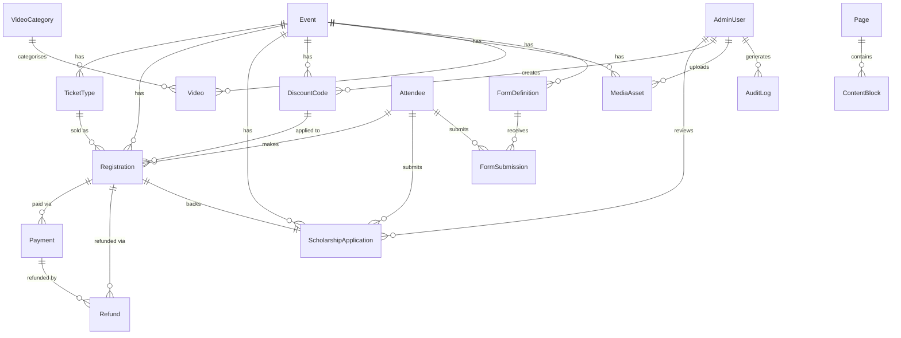
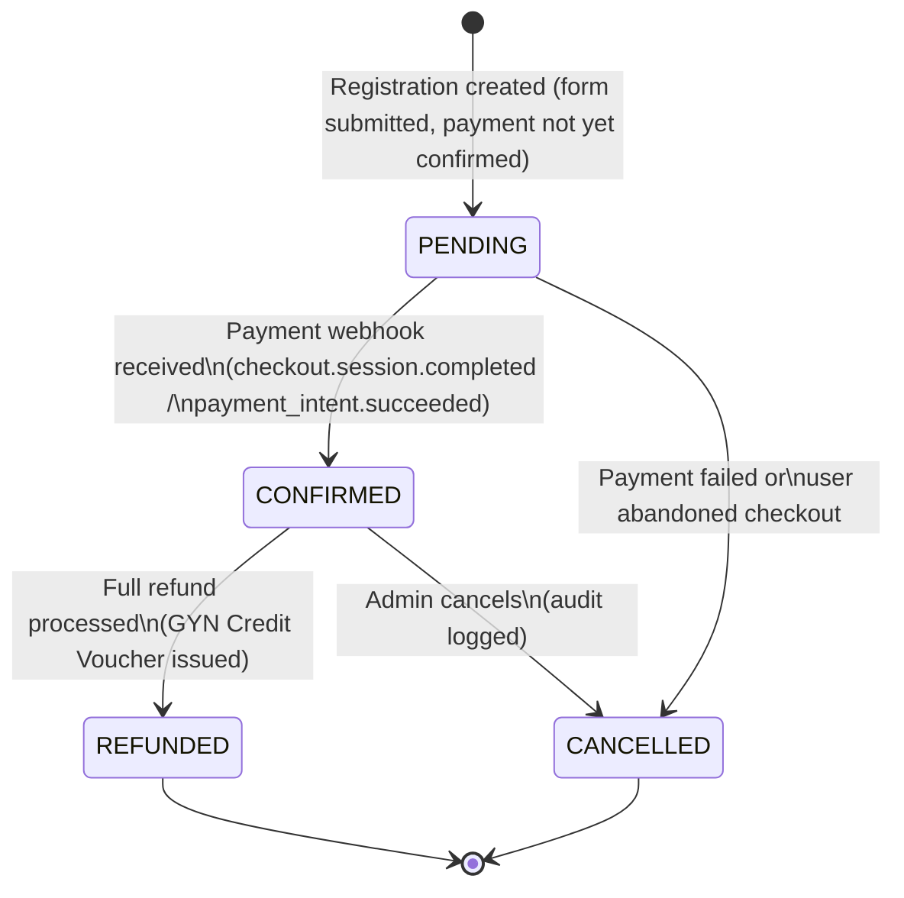
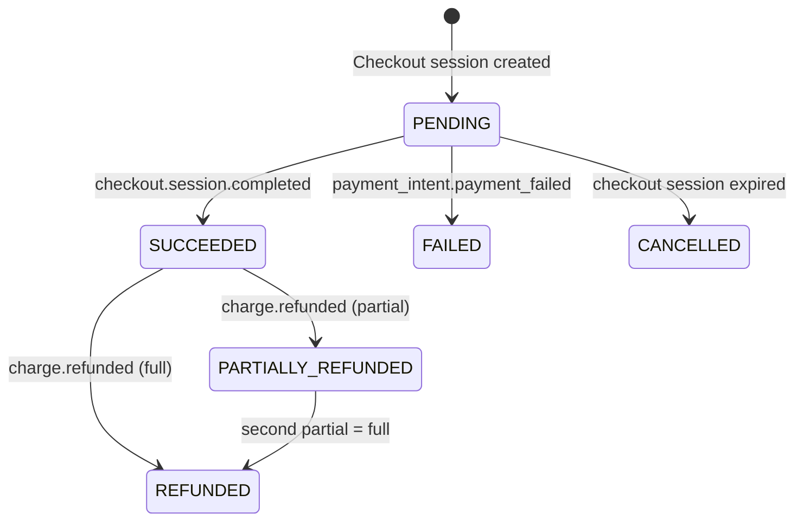

# Database schema

Prisma schema: `prisma/schema.prisma` · Provider: PostgreSQL

---

## ER diagram



---

## Model purposes

| Model | Purpose |
|---|---|
| **Event** | One row per summit (SISM 2026, FMST 2026, etc.). Slug matches the URL path. |
| **TicketType** | Purchasable tiers per event: scholarship ($18.50), forum-access ($199), self-funded ($399), invitation-letter ($49), plus unlisted/discounted variants. Prices stored in integer cents. |
| **Attendee** | Person record. Intentionally minimal PII. One person can register for multiple events; email is not unique across rows. |
| **Registration** | One row per purchase attempt. Captures a snapshot of the price paid (`finalAmountCents`) and holds an idempotency key so retried submissions do not double-book. |
| **Payment** | One or more payment attempts per registration (e.g. first attempt fails, second succeeds). Stores the provider's payment id so webhooks can look up the registration. |
| **Refund** | One row per refund action. All approved refunds are GYN Credit Vouchers (GCVs) per the published refund policy; a `CASH_ORIGINAL` override exists for the force-majeure clause. |
| **DiscountCode** | Group discount codes created by admin. The live site currently handles group discounts by email; this model supports self-serve codes in the future. |
| **ScholarshipApplication** | The reviewed application tied to a $18.50 scholarship payment. Stores the 250–300 word personal statement and the panel review outcome. |
| **Video** | YouTube video metadata (id, title, category). Avoids re-fetching oEmbed data on every page load. |
| **VideoCategory** | Highlight reels, testimonial shorts, summit recap, etc. |
| **MediaAsset** | Cloudinary-hosted images and videos. Stores the Cloudinary public id plus cached width/height/bytes so the frontend can build srcsets without hitting the Cloudinary API. |
| **Page** | CMS page record: slug, SEO fields, publish state. |
| **ContentBlock** | Ordered JSON blocks belonging to a page. Block schema is defined per `blockType` in application code or a `FormDefinition`. |
| **FormDefinition** | JSON Schema (draft-07) for a dynamic form (e.g. forum-access registration form). Allows adding fields without a migration. |
| **FormSubmission** | Raw (sanitised) submissions from a `FormDefinition`. Linked to an `Attendee` when the user is identified. |
| **AdminUser** | Internal users with RBAC roles: `SUPER_ADMIN`, `REVIEWER` (scholarship panel), `CONTENT_EDITOR`. |
| **AuditLog** | Immutable log of every admin action. Used for disputes and compliance. |
| **WebhookEvent** | Deduplication store for provider webhooks. The `providerEventId` unique constraint means a duplicate delivery from Stripe is a no-op. |

---

## Registration → Payment → Confirmation state machine



Payment sub-states (on the `Payment` model):



---

## Scholarship review flow

```mermaid
stateDiagram-v2
    [*] --> PENDING : Application submitted + $18.50 payment confirmed

    PENDING --> UNDER_REVIEW : Reviewer assigned by SUPER_ADMIN
    UNDER_REVIEW --> ACCEPTED : Score >= threshold,\nreviewer submits decision
    UNDER_REVIEW --> REJECTED : Score below threshold
    UNDER_REVIEW --> WAITLISTED : Score borderline;\nwaiting for withdrawals

    WAITLISTED --> ACCEPTED : Seat becomes available
    WAITLISTED --> REJECTED : Deadline passes, no seat

    ACCEPTED --> [*] : Confirmation email sent
    REJECTED --> [*] : Rejection email sent;\napplicant invited to purchase\nForum Access / Self-Funded
```

---

## Rows-per-year estimate

Assumptions (stated explicitly — actual application volume is unknown):

| Variable | Value | Source |
|---|---|---|
| Summits per year | 2 | FMST 2026 (Jul) + SISM 2026 (Nov); assumed stable |
| Confirmed seats per summit | 100 | `events.json` → `seats: 100` |
| Scholarship applicants per summit | 500–2,000 | **assumption**; competitive programmes receive 5–20× seats |
| Invitation letter purchases | 20–50 per summit | estimate; visa applicants are a subset of confirmed seats |

| Model | Rows/year | Arithmetic |
|---|---|---|
| Event | 2 | 2 summits |
| TicketType | ~10 | 5 types × 2 events |
| Attendee | ~250–500 | confirmed seats + scholarship applicants, some overlap |
| Registration | ~1,250–4,200 | 200 confirmed + 1,000–4,000 scholarship + 40–100 invitation letters |
| Payment | ~1,250–4,200 | ≈1 per registration (failed retries add ~10%) |
| ScholarshipApplication | ~1,000–4,000 | 500–2,000 per summit × 2 |
| Refund | <50 | rare; partial-funded delegates who cancel early |
| WebhookEvent | ~1,300–4,500 | every payment + refund + failed attempt |
| AuditLog | ~500–2,000 | admin actions on applications and registrations |
| MediaAsset | ~100 | gallery, speaker photos, OG images |

Scale verdict: this database will never exceed a few hundred thousand rows. A single Supabase hobby tier handles it comfortably. No sharding or partitioning needed for years.

---

## Retention and PII handling

### Retention policy

| Data category | Minimum retention | Reason |
|---|---|---|
| Registration, Payment, Refund | **3 years** from event date | Dispute window (credit card chargebacks up to 540 days); US non-profit record-keeping norms |
| AuditLog | **3 years** | Same dispute window |
| ScholarshipApplication | **2 years** | Re-applicants may reference past scores; no legal minimum identified |
| Attendee PII (name, email, phone) | **3 years** then anonymise | Minimise exposure post-retention |
| FormSubmission | **1 year** | Short-lived operational data |

Soft-delete (`deletedAt`) is used on all models where data must survive past a user's deletion request. A scheduled job should anonymise (null out) PII fields on `Attendee` rows where `deletedAt` is older than the retention period.

### Passport / NIC numbers

The live site collects passport or NIC numbers on the invitation-letter form and allows NIC/student ID as a substitute for passport on the scholarship form. The current `Attendee` model does **not** store these.

**Recommendation:** Do not store raw document numbers in the database.

Options in order of preference:

1. **Don't store at all.** The invitation-letter workflow only needs a document number to draft the letter. Generate the letter immediately and discard the number. This is sufficient if the admin drafts letters manually or via a template.

2. **Encrypt at the field level.** If the number must be retained (e.g. for visa follow-up), store it as an AES-256-GCM encrypted blob with the key in a secrets manager (AWS KMS, Supabase Vault). Add an `encryptedDocumentRef` field to `Registration` or a separate `InvitationLetterRequest` model. Decrypt only in the invitation-letter service layer, never log the plaintext.

3. **Store in a dedicated `DocumentReference` model** with a separate PostgreSQL role that application code does not have access to, and only the invitation-letter micro-service can read. This is the highest-isolation option.

Option 1 is chosen for the initial build. If visa-support workflows require retaining document numbers beyond letter generation, implement option 2 before launch.

The privacy policy currently lists "passport information" as collected; it should be updated to reflect that document numbers are processed but not stored.
